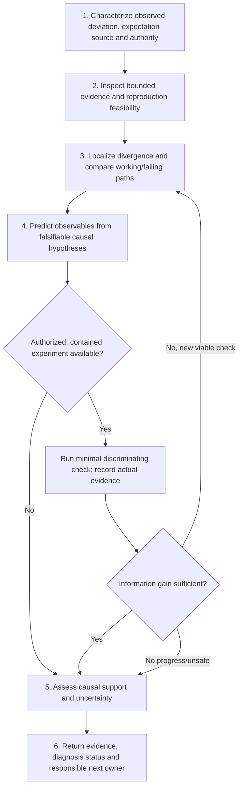

# Systematic Debugging

## Purpose

Investigate a specified technical failure and provide source-backed causal evidence for a separate authorized owner to decide the next action.

## Uses

* Rule: `contexts/debugging/rules/debugging.md`
* Output contract: `contracts/debugging-evidence.md`
* Optional source contracts: `contracts/requirements.md`, `contracts/test-basis.md`, `contracts/test-evidence.md`

## Working State

Keep a small investigation state: observed/expected behavior, source authority, inspected revision and environment, safety constraints, relevant events, reproduction status, hypotheses, counterevidence, executed checks, missing information and next owner.

## Workflow

The diagram governs the loop. Apply `contexts/debugging/rules/debugging.md` for safety, causal claims and scope, and `contracts/debugging-evidence.md` for handoff semantics.

* **Characterize:** check whether expected behavior is authoritative or merely reported, what actually failed, its operational impact and inspected source/environment identity. Unresolved product semantics go back to Requirements rather than being inferred from code.
* **Inspect:** read full relevant errors, bounded logs/traces, recent code/configuration changes, tests and existing telemetry. Prefer controlled reproduction, but retain `not-reproduced` or `not-attempted` without declaring the incident nonexistent.
* **Localize:** compare successful and failing paths, locate the earliest supported divergence and trace incorrect values backward across meaningful component boundaries. A symptom's location is not automatically the defect's source.
* **Hypothesize:** document candidate causes, the predicted observation that could refute each material hypothesis, and competing explanations. Run the smallest safe observation that separates them; do not stack speculative patches.
* **Experiment:** distinguish passive inspection, isolated test and potentially mutating operation. Without actual scoped permission, record an unexecuted proposal; do not edit source, write tests or deploy instrumentation. Reconsider the method when repeated attempts yield no new information.
* **Conclude and hand off:** emit `confirmed`, `probable`, `inconclusive` or `blocked` with inspected evidence and counterevidence. Assign Implementation, Requirements, Design, Testing, Review or Delivery/operations as next owner according to responsibility; no new authorization is conferred.

## Output

A concise `contracts/debugging-evidence.md`-compatible diagnosis: revision/scope, observations, tested hypotheses, causal assessment, limits, required next evidence and next responsible owner. Trivial cases may remain inline; no persistent artifact is mandatory.

## Boundary

Read-only by default; no code, tests, requirements, Git or infrastructure mutation, side-effecting probe, third-party installation, Review verdict or independent implementation readiness. A host must enforce actual tool permissions; Markdown is not a sandbox.

## Stop Conditions

Stop the affected line when a material expectation is undecided, source/evidence stale or missing, experiment unsafe or unauthorized, or further attempts produce no information. Preserve independently supported findings and mark the actual outcome `blocked` or `inconclusive`.
