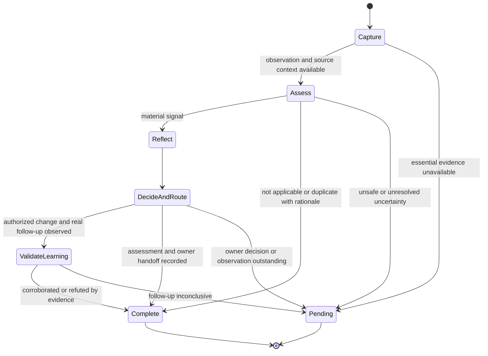

# Assess Feedback

## Purpose

Turn material observations into an evidence-based decision or an explicit unresolved question. This optional Skill works after any relevant activity, including a delivery or operational outcome handoff; it does not execute a corrective change.

## Uses

* Rule: `contexts/delivery/rules/delivery.md`
* Optional outcome contract: `contracts/outcome-evidence.md` for actual product or business outcomes
* Optional technical diagnosis: `contracts/debugging-evidence.md`
* Optional source evidence: relevant approved requirements, design, test, review, Git, runtime or agent-evaluation records

## State Model

## Working State

For the affected issue retain only material: the accepted objective/expectation, actual observation, source and version or execution identity, evidence provenance, risk/impact, competing explanations, contradictory or missing evidence, accountable decision owner, authorization constraints and any follow-up reference. An observation need not create a new artifact or persistent store.

## Workflow

Follow the State Model. The steps below describe each state; the diagram owns the transitions, explicit pending exits and stopping decisions.

The diagram owns the transitions. Apply these **evidence criteria** at the
relevant state, without creating a second numbered workflow:

* **Observation provenance:** Distinguish agent/tool/workflow execution from product outcomes; preserve expected behavior, actual observation, authoritative revision, execution or cohort identity, and whether evidence was inspected or merely reported. Do not acquire restricted data or mutate resources to improve the evidence.
* **Signal quality:** Assess relevance, impact, repeated signals, duplicates, freshness, uncertainty, measurement limits and counterexamples. Use `observed`, `inconclusive`, `pending` or justified `not-applicable` accurately; missing measurement is not success. Escalate urgent risks rather than iterating unsafely.
* **Causal humility:** Compare expectation and observation while retaining plausible alternate causes, including environmental or runtime changes, source drift and confounders. Consider single-loop correction under accepted rules versus double-loop reconsideration of assumptions, without claiming proof of cause.
* **Ownership and authorization:** Record the supported conclusion or unresolved question, proposed decision and next owner. Route technical diagnosis only through a separately authorized Debugging investigation; use `contracts/outcome-evidence.md` for product outcomes. A recommendation cannot approve changes to policy, stakeholder semantics, code, tests, Git state or external systems.
* **Learning claims:** Only if an independently authorized follow-up **actually occurred**, compare it with the baseline and side effects, reporting `corroborated`, `refuted` or `inconclusive` with evidence. Otherwise mark `pending`; return the assessment and relevant references without replaying Delivery or claiming a fix occurred.

## Output

Report: feedback kind, observed/expected comparison, source and execution identity, evidence/counterevidence and limits, impact, plausible explanation(s), single-loop or double-loop consideration if material, observation status, decision proposal or recorded owner decision, responsible owner, any authorized action and its independently checked outcome (or `pending`). Link existing `contracts/outcome-evidence.md` when assessing actual business outcomes rather than copying its fields. A short inline record is sufficient for low-risk cases.

## Boundary

Read-only analysis by default and when routed from /delivery/deliver-change without mutation authority. No self-approved rule edits, silent stakeholder semantic changes, automatic retries, repository mutation, Git operations, external tool installation, deployment, rollback, private transcript retention or new Review PASS. Available tools do not expand authorization. Another owner's eventual change and its follow-up verification are separate actions.

## Stop Conditions

Stop the affected decision when authoritative expected behavior, relevant source revision, material evidence or required permission cannot be established; when feedback would expose secrets/private records; when risk requires urgent owner intervention; or when repeated investigation yields no new information. Preserve independently supported conclusions and explicitly identify the next evidence or decision owner.
