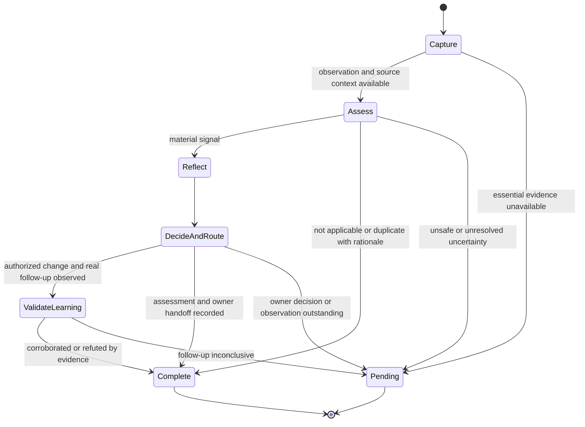

# Assess Feedback

## Purpose

Turn material observations into an evidence-based decision or an explicit unresolved question. This optional Skill works after any relevant activity, including a delivery or operational outcome handoff; it does not execute a corrective change.

## Uses

* Rule: `contexts/delivery/rules/delivery.md`
* Optional outcome contract: `contracts/outcome-evidence.md` for actual product or business outcomes
* Optional source evidence: relevant approved requirements, design, test, review, Git, runtime or agent-evaluation records

## State Model

## Working State

For the affected issue retain only material: the accepted objective/expectation, actual observation, source and version or execution identity, evidence provenance, risk/impact, competing explanations, contradictory or missing evidence, accountable decision owner, authorization constraints and any follow-up reference. An observation need not create a new artifact or persistent store.

## Workflow

Follow the State Model. The steps below describe each state; the diagram owns the transitions, explicit pending exits and stopping decisions.

1. **Scope and capture.** Identify whether the request concerns operational feedback (agent behavior, tools, prompts, workflow) or product outcome feedback, or both. Keep the two assessments distinct. Establish the expected behavior from an authoritative source where available; record the actual observation and the source revision, execution trace, time window or cohort needed to interpret it. If evidence is merely reported rather than inspected, label it as such. Do not fetch restricted data or mutate anything to obtain evidence.
2. **Assess signal.** Check relevance, impact, repetition, duplicates, safety, evidence freshness, sample/measurement limitations and plausible counterexamples. Consolidate equivalent observations without losing source identities. Distinguish `observed`, `inconclusive`, `pending` and justified `not-applicable`; avoid interpreting an absent measurement as success or failure. Escalate urgent risks to the responsible owner instead of continuing an unsafe iteration.
3. **Reflect.** Compare expectation with observation and state explanations as hypotheses, not findings of causal proof. Test whether a single-loop correction under existing rules or a double-loop review of governing assumptions and ownership is warranted. Consider alternate causes, including environment, model/runtime changes, source drift and confounders; preserve uncertainty when competing explanations cannot be distinguished.
4. **Decide and route.** Record the supported conclusion or open question, its rationale, next responsible owner and proposed choice: keep, obtain evidence, investigate, revise an execution practice, or request reconsideration of a governing decision. For product outcomes, use `contracts/outcome-evidence.md` semantics without rewriting its business assessment. Respect accepted requirement authority and specialist ownership; a recommendation does not approve new work, modify policy, or authorize code, test, Git, deployment, rollback or other effects.
5. **Validate learning when evidence exists.** If a separately authorized change was actually made, compare follow-up observations with the original baseline and relevant counterexamples, checking side effects and regressions at proportionate rigor. Report whether the specific improvement claim is `corroborated`, `refuted` or `inconclusive`, with evidence and limitations. Without a real follow-up, record `pending` and a next observation owner; do not invent successful experiments or declare a changed prompt/skill an effective fix.
6. **Finish or hand off.** Return the concise assessment and source references to the requester or correct owner. Affected specialists may start new authorized work using existing commands. Do not loop back through the full delivery pipeline, automatically promote lessons to canonical rules, or claim that a proposed corrective action has been implemented.

## Output

Report: feedback kind, observed/expected comparison, source and execution identity, evidence/counterevidence and limits, impact, plausible explanation(s), single-loop or double-loop consideration if material, observation status, decision proposal or recorded owner decision, responsible owner, any authorized action and its independently checked outcome (or `pending`). Link existing `contracts/outcome-evidence.md` when assessing actual business outcomes rather than copying its fields. A short inline record is sufficient for low-risk cases.

## Boundary

Read-only analysis by default and when routed from /delivery/deliver-change without mutation authority. No self-approved rule edits, silent stakeholder semantic changes, automatic retries, repository mutation, Git operations, external tool installation, deployment, rollback, private transcript retention or new Review PASS. Available tools do not expand authorization. Another owner's eventual change and its follow-up verification are separate actions.

## Stop Conditions

Stop the affected decision when authoritative expected behavior, relevant source revision, material evidence or required permission cannot be established; when feedback would expose secrets/private records; when risk requires urgent owner intervention; or when repeated investigation yields no new information. Preserve independently supported conclusions and explicitly identify the next evidence or decision owner.
