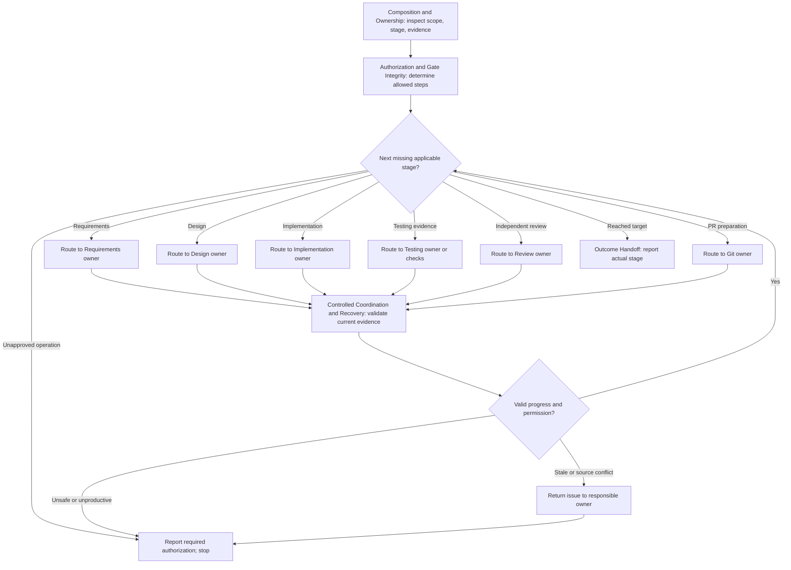

# Coordinate Delivery

## Purpose

Carry a change toward the explicitly authorized target stage, selecting only the required specialist capabilities and preserving decisions and evidence across handoffs.

## Uses

* Rule: `contexts/delivery/rules/delivery.md`
* Input contract: `contracts/requirements.md` when available
* Input contract: `contracts/work-item.md` when available
* Input contract: `contracts/design-evidence.md` when available
* Input/output contract: `contracts/test-basis.md` when available
* Input/output contract: `contracts/test-evidence.md` when available
* Input/output contract: `contracts/review-evidence.md` when available
* Optional output contract: `contracts/outcome-evidence.md`

## Working State

Track `target_stage`, authorized operations and restrictions, Change Boundary, available accepted baselines, per-slice dependencies/readiness, source and repository snapshot identities, owned specialist outputs, verification and review evidence, external effects, pending decisions, and current outcome status. Never invent checkpoint persistence.

## Workflow

This explicit cross-context workflow permits **routing** existing specialist capabilities; they continue to own their procedures and authorization gates. `/requirements/specify-and-plan-change` (where available; legacy hosts may still expose `shape-change`) performs Requirements-only composition, not the full delivery sequence. Review keeps the sole technical verdict. No tool execution is implied merely by this Markdown procedure.

## Output

Report the actual reached stage, per-slice completed and blocked work, applicable source and code identities, specialist evidence, checks, Review verdict where performed, pending authorizations, recovery risks, next owners and unresolved outcome observations. When supplied, report an optional `contracts/outcome-evidence.md`-compatible observation handoff; never fabricate deployment or results.

## Boundary

Never silently expand scope, execute an unapproved mutation, promote self-review to independent gate, replay unsafe side effects, push, create/merge PRs, deploy, release or claim operational effectiveness without corresponding explicit authorization/evidence.

## Stop Conditions

Stop the affected path on missing material authority or source meaning, stale evidence that cannot be refreshed, unsafe shared writes, unknown side effects, repeated non-progress, or mandatory checks that cannot run. Preserve completed independent work.
