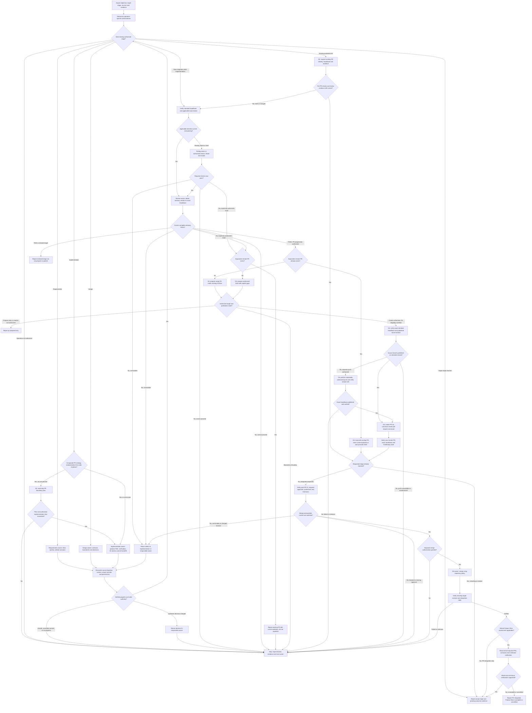

# Coordinate Delivery

## Purpose

Carry a change toward the explicitly authorized target stage, selecting only the required specialist capabilities and preserving decisions and evidence across handoffs.

## Uses

* Rule: `contexts/delivery/rules/delivery.md`
* Input contract: `contracts/requirements.md` when available
* Input contract: `contracts/work-item.md` when available
* Input contract: `contracts/design-evidence.md` when available
* Input/output contract: `contracts/test-basis.md` when available
* Input/output contract: `contracts/test-evidence.md` when available
* Input/output contract: `contracts/review-evidence.md` when available

## Working State

Preserve a small slice-scoped context selection: source and baseline references, accepted Change Boundary, applicable scenarios and critical guarantees, needed design/code/test references, checked revision/freshness, missing sources and the current owner. Keep references separate from verified retrieved content.

Track the governing Product Slice or learning objective, source obligation/scenario identities, contributing PR Boundaries and their actual integration status, integrated target revisions and cross-PR verification evidence when material, alongside the next step.

Track `target_stage`, authorized operations and restrictions, Change Boundary, existing or planned Git PR Boundary, available accepted baselines, per-slice dependencies/readiness, intended and actual PR head/base, local verification and independent Review evidence identity, review profile and verdict, preparation state, published PR status, post-publication checks/approvals, merge authorization and observed target state, commit authorization and observed SHA or uncommitted/blocked state, owned specialist outputs, external effects, pending decisions, and current outcome status. Never invent checkpoint persistence.

## Workflow

This explicit cross-context workflow permits **routing** existing specialist capabilities; they continue to own their procedures and authorization gates. Requirements owns its internal elicitation/validation/backlog loop, Implementation owns its optional TDD and atomic Git commit handoffs, Review owns its verdict and Git owns PR planning, preparation, creation and merge. The diagram intentionally does not duplicate those internal workflows. Resolve Requirements composition against the **actually installed command**: use `/requirements/specify-and-plan-change` when the renamed command is present (independent PR #31), or `/requirements/shape-change` when the current installation still provides the original command. Verify the entry point exists before routing; do not assume an uninstalled command or a host alias. Both are Requirements-only and do not authorize the full delivery sequence. Review keeps the sole technical verdict. No tool execution is implied merely by this Markdown procedure.

## Git Planning and Commit Handoffs

* Before any implementation mutation of a composite initiative, request Git's read-only `plan` via `contexts/git/skills/manage-pull-request/SKILL.md` unless the PR Boundary is already current. Pass the resulting scope, base and dependencies to Implementation without expanding authorization.
* During Implementation, pass the caller's local-commit permission and await the Git Engineer's actual verified commit SHA or explicit blocked/uncommitted state. A requested commit or passing check alone never establishes commit success.
* After Implementation, use independent Review and the Git `prepare` operation as separate stages. `create`, push, merge, release and deployment require separate permissions.

## Integration Handoffs

* After Implementation, route final code/commit identity and verification evidence into Integration; collect missing authorized tests/lint with their actual execution scope, then request independent Code Review through Review's existing capability. Review owns the single verdict; the Git PR readiness rule decides which evidence permits a ready PR.
* An advisory `PASS` on the current intended head/base permits Git `prepare` for ready status when other checks pass. On `FAIL`, `INCOMPLETE`, or stale evidence, route correctable work to its owner and reverify affected outputs, or prepare/publish **only an explicitly authorized Draft** with truthful limitations under the Git rule.
* Git owns PR `prepare` and separately authorized `create`. A request for `pr-prepared` stops before publication; a request for `pr-created` stops after verifying the remote PR. **Before `create`, Git verifies the intended source branch exists on the correct remote at the exact reviewed head and confirms the intended base.** If unpublished, stop and report the blocker unless push was **separately authorized**; only Git may perform that push, and remote identity must be reverified before creation. Never infer push from create authorization or merge from a created PR.
* For an **existing published PR**, check its current remote head/base and pre-PR review/check evidence. If stale, revalidate through the same verification and Review owners, but **resume the existing PR** instead of routing to another `create`. Never implicitly convert an existing Draft to ready, and do not claim that a fresh Review authorizes its remote status change. A correctable defect returns to its owner; unverified readiness remains explicitly pending.
* After creation or resumption of an existing PR, collect actual post-PR checks and required approvals for the current PR head/base. If code changes, return affected work to Implementation and revalidate necessary checks and independent Review. Confirm **separate merge authorization** after technical prerequisites, then merge only through the Git owner when repository protections are satisfied and verify the resulting target branch before reporting `integrated`.
* Evaluate Product Slice-wide technical completeness after an observed merge **only when applicable**. A safe merged Architectural Slice/PR is still a valid integration result even when a broader Product Slice is incomplete or cannot yet be verified.

## Slice-Scoped Context Handoffs

1. Identify the next authorized slice, target decision and intended specialist. Reuse its `context_id`, `change_boundary_ref`, `scenario_refs`, `source_baseline_ref`, `slice_ref` and other existing contract references when available; do not invent IDs or require a new file.
2. Assemble only the material goal, accepted scope, expected observable result or learning, relevant constraints and **critical guarantees**, versioned source references, unresolved decisions, and evidence needed for that specialist. Retain dependency and parent-goal references when omitting detail would mislead.
3. For details not yet needed, pass an actionable source reference rather than copying entire histories, transcripts or unrelated files. Retrieve additional code, rules, examples or test evidence **on demand** using authorized tools; distinguish referenced, actually retrieved, and verified information.
4. Reconcile the source baseline, material decisions, shared contract and actual code/PR revision at the receiving handoff, resumption and pre-gate use. If new evidence invalidates an assumption, reselect the affected context and request updated specialist evidence instead of silently preserving an obsolete summary.
5. If a relevant source, authority or critical guarantee cannot be verified, report the gap and next owner; block only the dependent decision. Never solve a context limit by dropping safety or acceptance obligations or by requesting unauthorized secrets/remote data.

This procedure reuses `contracts/work-item.md`, `contracts/design-evidence.md`, `contracts/test-basis.md` and existing source identifiers; it does **not** define a new context-packet contract or mandate a retrieval engine.

## Product Slice Completion Handoff

* For a Product Slice spanning multiple PRs, reconcile each required PR's actual merge status and target revision with the original Work Item, Change Boundary, and accepted scenario or learning objective. Explicitly account for pending, deferred, removed, and superseded obligations based on authorized decisions.
* Verify the combined result when cross-PR interfaces, behavior, migration, or guarantees can interact. Use real integrated-snapshot test evidence or an appropriately scoped verification source; green PR checks alone do not establish combined correctness. When the overall slice is not complete or its evidence is unavailable, report the exact remaining scenarios and next responsible owner.
* Return separately the **PR integration status**, **Product Slice technical verification status**, **business/stakeholder acceptance**, and **outcome observation**. Never infer acceptance, rollout, or value from merged PRs. A learning slice can instead close with an evidence-backed learning result and a recorded decision, not a fictional feature delivery.

## Output

Report the actual reached stage, per-slice completed and blocked work, applicable source, implementation and PR head/base identities, PR Boundary, Git-verified commits or explicit uncommitted/blocked state, specialist evidence, independent Review profile/verdict and tested scope where performed, readiness and remote PR status when available, post-PR checks/approvals, merge verification only when observed, Product Slice coverage and integrated-behavior evidence or explicit incompleteness when applicable, pending authorizations, recovery risks, next owners and unresolved outcome observations.

## Boundary

Never silently expand scope, execute an unapproved mutation, promote self-review to independent gate, replay unsafe side effects, push, create/merge PRs, deploy, release or claim operational effectiveness without corresponding explicit authorization/evidence.

## Stop Conditions

Stop the affected path on missing material authority or source meaning, stale evidence that cannot be refreshed, unsafe shared writes, unknown side effects, repeated non-progress, or mandatory checks that cannot run. Preserve completed independent work.
