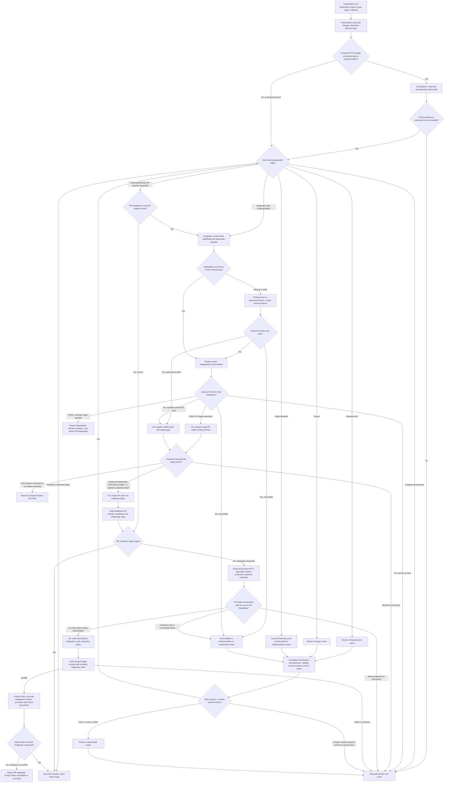

# Coordinate Delivery

## Purpose

Carry a change toward the explicitly authorized target stage, selecting only the required specialist capabilities and preserving decisions and evidence across handoffs.

## Uses

* Rule: `contexts/delivery/rules/delivery.md`
* Input contract: `contracts/requirements.md` when available
* Input contract: `contracts/work-item.md` when available
* Input contract: `contracts/design-evidence.md` when available
* Input/output contract: `contracts/test-basis.md` when available
* Input/output contract: `contracts/test-evidence.md` when available
* Input/output contract: `contracts/review-evidence.md` when available

## Working State

Track the governing Product Slice or learning objective, source obligation/scenario identities, contributing PR Boundaries and their actual integration status, integrated target revisions and cross-PR verification evidence when material, alongside the next step.

Track `target_stage`, authorized operations and restrictions, Change Boundary, existing or planned Git PR Boundary, available accepted baselines, per-slice dependencies/readiness, intended and actual PR head/base, local verification and independent Review evidence identity, review profile and verdict, preparation state, published PR status, post-publication checks/approvals, merge authorization and observed target state, commit authorization and observed SHA or uncommitted/blocked state, owned specialist outputs, external effects, pending decisions, and current outcome status. Never invent checkpoint persistence.

## Workflow

This explicit cross-context workflow permits **routing** existing specialist capabilities; they continue to own their procedures and authorization gates. `/requirements/specify-and-plan-change` (where available; legacy hosts may still expose `shape-change`) performs Requirements-only composition, not the full delivery sequence. Review keeps the sole technical verdict. No tool execution is implied merely by this Markdown procedure.

## Git Planning and Commit Handoffs

* Before any implementation mutation of a composite initiative, request Git's read-only `plan` via `contexts/git/skills/manage-pull-request/SKILL.md` unless the PR Boundary is already current. Pass the resulting scope, base and dependencies to Implementation without expanding authorization.
* During Implementation, pass the caller's local-commit permission and await the Git Engineer's actual verified commit SHA or explicit blocked/uncommitted state. A requested commit or passing check alone never establishes commit success.
* After Implementation, use independent Review and the Git `prepare` operation as separate stages. `create`, push, merge, release and deployment require separate permissions.

## Integration Handoffs

* After Implementation, route final code/commit identity and verification evidence into Integration; collect missing authorized tests/lint with their actual execution scope, then request independent Code Review through Review's existing capability. Review owns the single verdict; the Git PR readiness rule decides which evidence permits a ready PR.
* An advisory `PASS` on the current intended head/base permits Git `prepare` for ready status when other checks pass. On `FAIL`, `INCOMPLETE`, or stale evidence, route correctable work to its owner and reverify affected outputs, or prepare/publish **only an explicitly authorized Draft** with truthful limitations under the Git rule.
* Git owns PR `prepare` and separately authorized `create`. A request for `pr-prepared` stops before publication; a request for `pr-created` stops after verifying the remote PR. Do not infer push from create authorization or merge from a created PR.
* After creation, collect actual post-PR checks and required approvals for the current PR head/base. If code changes, return affected work to Implementation and revalidate necessary checks and independent Review. Merge only through separately authorized Git integration when repository protections are satisfied, and verify the resulting target branch before reporting `integrated`.

## Product Slice Completion Handoff

* For a Product Slice spanning multiple PRs, reconcile each required PR's actual merge status and target revision with the original Work Item, Change Boundary, and accepted scenario or learning objective. Explicitly account for pending, deferred, removed, and superseded obligations based on authorized decisions.
* Verify the combined result when cross-PR interfaces, behavior, migration, or guarantees can interact. Use real integrated-snapshot test evidence or an appropriately scoped verification source; green PR checks alone do not establish combined correctness. When the overall slice is not complete or its evidence is unavailable, report the exact remaining scenarios and next responsible owner.
* Return separately the **PR integration status**, **Product Slice technical verification status**, **business/stakeholder acceptance**, and **outcome observation**. Never infer acceptance, rollout, or value from merged PRs. A learning slice can instead close with an evidence-backed learning result and a recorded decision, not a fictional feature delivery.

## Output

Report the actual reached stage, per-slice completed and blocked work, applicable source, implementation and PR head/base identities, PR Boundary, Git-verified commits or explicit uncommitted/blocked state, specialist evidence, independent Review profile/verdict and tested scope where performed, readiness and remote PR status when available, post-PR checks/approvals, merge verification only when observed, Product Slice coverage and integrated-behavior evidence or explicit incompleteness when applicable, pending authorizations, recovery risks, next owners and unresolved outcome observations.

## Boundary

Never silently expand scope, execute an unapproved mutation, promote self-review to independent gate, replay unsafe side effects, push, create/merge PRs, deploy, release or claim operational effectiveness without corresponding explicit authorization/evidence.

## Stop Conditions

Stop the affected path on missing material authority or source meaning, stale evidence that cannot be refreshed, unsafe shared writes, unknown side effects, repeated non-progress, or mandatory checks that cannot run. Preserve completed independent work.
