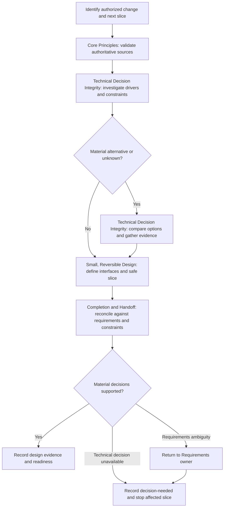

# Design Solution

## Purpose

Produce enough technical decisions and interface detail to implement the next bounded slice, without re-specifying requirements or editing code.

## Uses

* Rule: `contexts/design/rules/design.md`
* Input contract: `contracts/requirements.md` when available
* Input contract: `contracts/work-item.md` when available
* Output contract: `contracts/design-evidence.md`

## Working State

Maintain only material source baseline/Change Boundary, candidate slice, constraints, affected owners and interfaces, evidence and unknowns, alternatives and rationale, decision authority, compatibility/recovery needs, and readiness.

## Workflow

Apply the named sections in `contexts/design/rules/design.md`; do not copy their invariants into this procedure. Analyze independent concerns in parallel only when evidence and contract reconciliation are possible.

## Output

Produce `contracts/design-evidence.md`-compatible decisions, alternatives when material, interface/behavior realization, risks, relevant assumptions, source references, verification needs, and explicit readiness for the intended slice. Record unresolved issues rather than manufacturing decisions.

## Boundary

Read-only design reasoning unless a separately authorized operation permits writing design documents. No production/test code edits, Git mutations, requirement approvals, deployment, or claims of successful verification.

## Stop Conditions

Stop the affected design when source authority, shared contract, risk-sensitive guarantee, or required technical decision is materially unresolved; report the next responsible owner and retained evidence.
