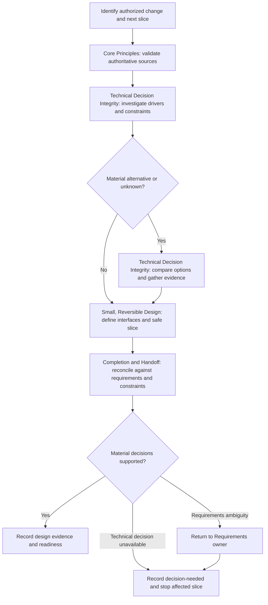

# Design Solution

## Purpose

Produce enough technical decisions and interface detail to implement the next bounded slice, without re-specifying requirements or editing code.

## Uses

* Rule: `contexts/design/rules/design.md`
* Input contract: `contracts/requirements.md` when available
* Input contract: `contracts/work-item.md` when available
* Output contract: `contracts/design-evidence.md`

## Working State

Maintain only material source baseline/Change Boundary, candidate slice, constraints, affected owners and interfaces, evidence and unknowns, alternatives and rationale, decision authority, compatibility/recovery needs, and readiness.

## Workflow

Apply the named sections in `contexts/design/rules/design.md`; do not copy their invariants into this procedure. Analyze independent concerns in parallel only when evidence and contract reconciliation are possible. For an HTTP API contract or behavioral change, load only the relevant sections of [HTTP API design guidance](references/http-api-design.md) before selecting the design; distinguish applicable protocol semantics from optional architecture and provider conventions. For an output boundary, public response shape, field disclosure or sensitive-data transformation, select only the relevant [output contracts and data protection guidance](references/output-contracts-and-data-protection.md), including for non-HTTP interfaces. For a collection-query change involving pagination, sorting, filtering, field projection or related resource expansion, consult [collection query design guidance](references/collection-query-design.md) only for the relevant concerns. For material refactoring or legacy displacement, load `references/refactoring-options.md` as [conditional selection guidance](references/refactoring-options.md); keep the selected strategy, compared alternatives and preservation obligations in the existing `contracts/design-evidence.md` handoff rather than inventing a second design contract.

For a relational schema or derived read-model change, consult the relevant parts of [relational data design guidance](references/relational-data-design.md) only when dependencies, normalization, decompositions, indexing, materialization or denormalization are material to the decision; do not impose relational techniques on unrelated storage. Keep evidence and decisions in the existing `contracts/design-evidence.md` handoff.

## Output

Produce `contracts/design-evidence.md`-compatible decisions, alternatives when material, interface/behavior realization, risks, relevant assumptions, source references, verification needs, and explicit readiness for the intended slice. Record unresolved issues rather than manufacturing decisions.

## Boundary

Read-only design reasoning unless a separately authorized operation permits writing design documents. No production/test code edits, Git mutations, requirement approvals, deployment, or claims of successful verification.

## Stop Conditions

Stop the affected design when source authority, shared contract, risk-sensitive guarantee, or required technical decision is materially unresolved; report the next responsible owner and retained evidence.
