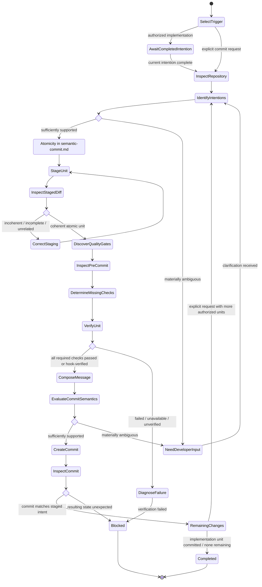

# Create Semantic Commits

## Purpose

Use for each completed intention during authorized implementation, or to partition an explicitly requested change set into the smallest coherent sequence of atomic commits. Apply the same Git and semantic-commit rules in either mode.

## Uses

* Rule: `contexts/git/rules/git.md`
* Rule: `contexts/git/rules/semantic-commit.md`

## Preconditions

* Local commits are permitted by a scoped implementation task, or commit creation is explicitly requested for a defined change set.
* The repository is inspectable.
* No unresolved Git operation or conflict makes committing unsafe.
* The authorized change set can be distinguished from unrelated work.

## Workflow

The diagram is the procedure. Apply the shared quality-gate discovery and evidence policy in `contexts/git/rules/git.md`. Apply atomicity and message shape in `contexts/git/rules/semantic-commit.md`. Do not restate those rules.

## Boundaries

* Commit authorization permits staging and partitioning the already-authorized changes, but it does not authorize editing production or test implementation to make verification pass.
* Commit authorization does not authorize push, merge, rebase of shared history, tag, release, branch deletion, worktree mutation, or remote-ref mutation.
* Do not bypass hooks, required checks, branch protections, signing requirements, or repository policy.
* Do not install/configure coverage tooling, create coverage thresholds, or change test policy merely to satisfy commit verification unless separately authorized.
* Hook presence alone is not verification evidence; follow the shared evidence-scope and freshness policy in `contexts/git/rules/git.md`.
* Do not amend or rewrite published history unless separately authorized and sufficiently verified.

## Output

Report the commits created, the logical intent of each commit, discovered quality gates, checks satisfied explicitly or by the effective hook, coverage mode used when applicable, remaining changes, and any blocked or unresolved state. Never claim a commit exists without repository evidence.
