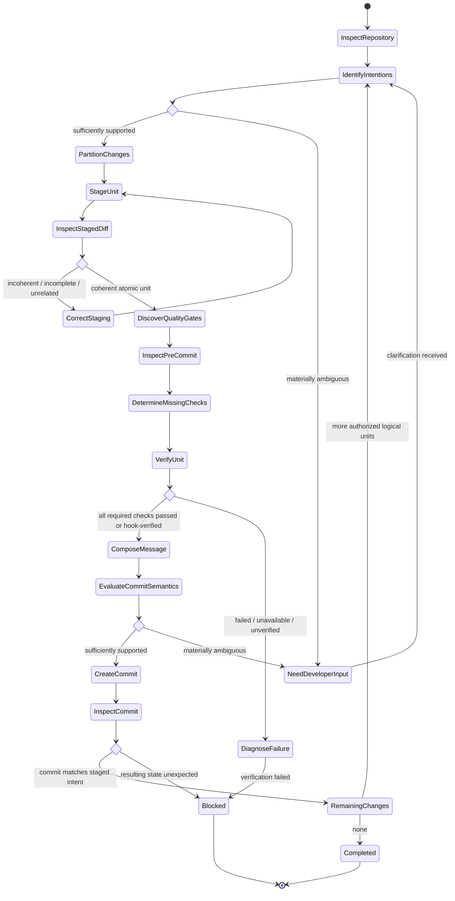

# Create Semantic Commits

## Purpose

Use when a task explicitly authorizes creating one or more commits. Convert an authorized set of changes into the smallest coherent sequence of atomic commits while applying the Git and semantic-commit rules.

## Uses

* Rule: `contexts/git/rules/git.md`
* Rule: `contexts/git/rules/semantic-commit.md`

## Preconditions

* Creating commits is explicitly authorized for a defined change scope.
* The repository is inspectable.
* No unresolved Git operation or conflict makes committing unsafe.
* The authorized change set can be distinguished from unrelated work.

## Operational Graph

## Workflow

1. Inspect the current branch, upstream, working tree, staged changes, unstaged changes, relevant diff, nearby commit conventions, and explicit developer context.
2. Identify the logical intentions and dependencies represented by the authorized changes.
3. If semantic intent or the relationship between changes is materially ambiguous, ask before partitioning or committing.
4. Partition the authorized changes into the smallest coherent set of atomic commits. Do not partition by file boundaries alone, and do not keep two intents together because they share a file. A file that contains two intents is split with hunk staging. The cost of hunk staging does not justify one commit. The misleading-intermediate exception applies only when no hunk cut leaves each commit coherent and verifiable. Reaching for that exception to avoid hunk staging is the ambiguous case: split or ask. Do not resolve it by committing once.
5. Preserve unrelated pre-existing staged and working-tree changes.
6. Stage exactly one logical unit, using path- or hunk-level staging when necessary.
7. Inspect the complete staged diff.
8. Correct staging when it contains independent intents, unrelated changes, or omits changes required for a coherent and verifiable unit.
9. Discover the repository's established pre-commit quality gates before creating the commit:
   * identify the repository-defined lint command when one exists;
   * identify the repository-defined test command when one exists;
   * determine whether coverage is an established capability or policy from scripts, test/coverage configuration, CI, or project documentation; do not infer this from a dependency alone;
   * identify any additional repository-required quality gates.
10. Inspect the effective pre-commit mechanism, including Git hook-path configuration and repository-managed hook tooling when material, and determine which required checks it actually executes.
11. Calculate the missing explicit checks per quality gate:
   * do not rerun a check separately when the effective hook is verified to execute the same check at an equivalent or stronger scope;
   * run lint explicitly when available and not equivalently covered by the hook;
   * run tests explicitly when available and not equivalently covered by the hook;
   * when coverage is established, use the established coverage-enabled test command unless the hook already performs equivalent coverage verification;
   * when coverage is not established, run normal tests and do not introduce coverage tooling/configuration under commit-only authorization.
12. Run every missing required check before commit creation. Do not skip lint or tests merely because the staged change appears low risk or documentation-only when those checks are repository-wide commit gates.
13. If a required available check fails, cannot run, or cannot be verified, diagnose enough to report the failure and block commit creation. Do not modify production/test implementation or weaken the gate under commit-only authorization.
14. Derive type, scope, summary, body, breaking-change metadata, and references from the staged diff and verified context.
15. Ask before committing when material commit semantics remain ambiguous.
16. Create the commit only when the staged diff and message describe the same logical unit and all required pre-commit checks are passed or equivalently verified through the effective hook.
17. Inspect the resulting commit and repository status.
18. Repeat for remaining authorized logical units. Re-evaluate checks when repository state, staged content, or hook behavior materially changes.
19. Stop when repository state is ambiguous, required verification is unavailable or fails, a material blocker remains, or continuing would require changing implementation semantics beyond staging/partitioning the already-authorized change set.

## Boundaries

* Commit authorization permits staging and partitioning the already-authorized changes, but it does not authorize editing production or test implementation to make verification pass.
* Commit authorization does not authorize push, merge, rebase of shared history, tag, release, branch deletion, worktree mutation, or remote-ref mutation.
* Do not bypass hooks, required checks, branch protections, signing requirements, or repository policy.
* Do not install/configure coverage tooling, create coverage thresholds, or change test policy merely to satisfy commit verification unless separately authorized.
* Hook presence alone is not verification evidence; only checks proven to run through the effective pre-commit path may replace explicit execution.
* Do not amend or rewrite published history unless separately authorized and sufficiently verified.

## Output

Report the commits created, the logical intent of each commit, discovered quality gates, checks satisfied explicitly or by the effective hook, coverage mode used when applicable, remaining changes, and any blocked or unresolved state. Never claim a commit exists without repository evidence.
