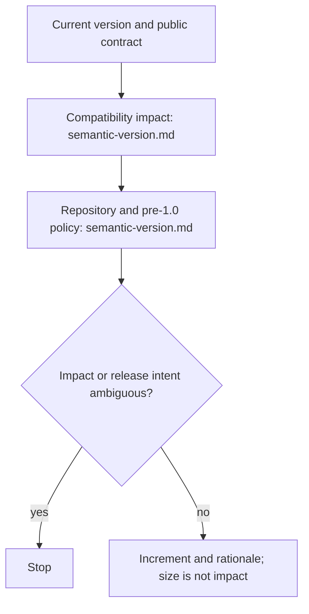

# Determine Semantic Version

## Purpose

Use to determine a semantic-version increment from verified compatibility impact and repository release policy without inventing release intent.

## Uses

* Rule: `contexts/git/rules/git.md`
* Rule: `contexts/git/rules/semantic-version.md`

Optional requirements, work items, release notes, issues, or developer context may provide evidence of intended public behavior. They do not replace inspection of actual compatibility impact.

## Working State

Maintain:

* current verified version;
* repository versioning and release policy;
* relevant public API, consumer contract, or compatibility surface;
* actual changes and documented intent;
* pre-1.0 or repository-specific semantics when applicable;
* unresolved compatibility or release-intent ambiguity.

## Workflow

The diagram is the procedure. Apply `contexts/git/rules/semantic-version.md`. Do not restate it.

## Stop Conditions

Stop and surface the issue when:

* the current version cannot be verified;
* applicable versioning or release policy is missing or conflicting in a way that changes the result;
* compatibility impact cannot be established from available evidence;
* release intent is required to choose a version and remains materially ambiguous;
* continuing would require inventing a public contract or compatibility assumption.

## Output

Return the current version, proposed increment, resulting version when computable, compatibility rationale, supporting evidence, and unresolved issues.

## Boundary

Determining a version does not authorize editing version files, creating commits, tagging, pushing, publishing, deploying, or releasing.
