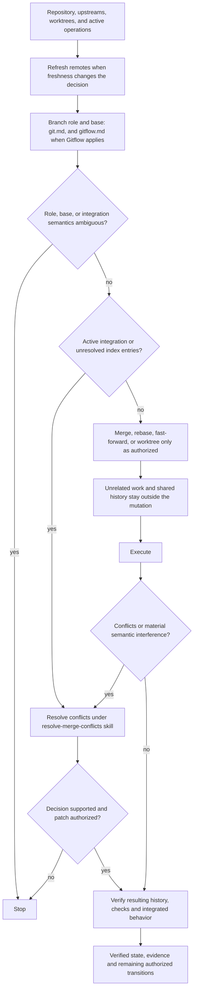

# Manage Branch Work

## Purpose

Use for authorized branch, synchronization, integration, or worktree operations when repository policy and verified branch intent determine the safe procedure.

## Uses

* Rule: `contexts/git/rules/git.md`
* Rule: `contexts/git/rules/gitflow.md` only when Gitflow applies.
* Skill: `contexts/git/skills/resolve-merge-conflicts/SKILL.md` for integration conflicts and interfering changes.

## Working State

Maintain:

* current branch and verified branch role;
* upstream and relevant remote references;
* publication state and shared-history constraints;
* active merge, rebase, cherry-pick, bisect, or conflict state;
* applicable repository workflow and integration policy;
* worktree occupancy and parallel-work constraints;
* explicit authorization scope, including separate conflict edit/stage/continue permissions;
* relevant conflict stages and semantic interaction risks;
* verification evidence and unresolved ambiguity.

## Workflow

The diagram is the procedure. Apply `contexts/git/rules/git.md` and, when Gitflow applies, `contexts/git/rules/gitflow.md`. The conflict branch uses `contexts/git/skills/resolve-merge-conflicts/SKILL.md`; it never implicitly continues or commits a partially resolved operation.

## Parallel Work

Use dedicated worktrees only when tasks are sufficiently independent. Serialize tightly coupled or substantially overlapping work. A worktree isolates a working tree and index, not repository-level refs, objects, or all shared operations.

## Stop Conditions

Stop and surface the issue when:

* branch role, integration target, or publication state remains materially ambiguous;
* the safe operation would require authorization for an additional mutation;
* a conflict or active Git operation cannot be resolved within the authorized scope;
* required remote freshness, repository policy, signing, or verification evidence is unavailable;
* the operation would rewrite shared history, discard unrelated work, or mutate an unapproved remote ref;
* repeated conflict-resolution or verification attempts are not making meaningful progress.

## Output

Report the operation performed, relevant before/after refs or branch state, verification evidence, remaining work, and any blocked or unresolved condition.

## Boundary

Branch-work authorization does not imply permission to push, delete remote refs, rewrite published history, tag, publish, deploy, or release unless separately authorized.
