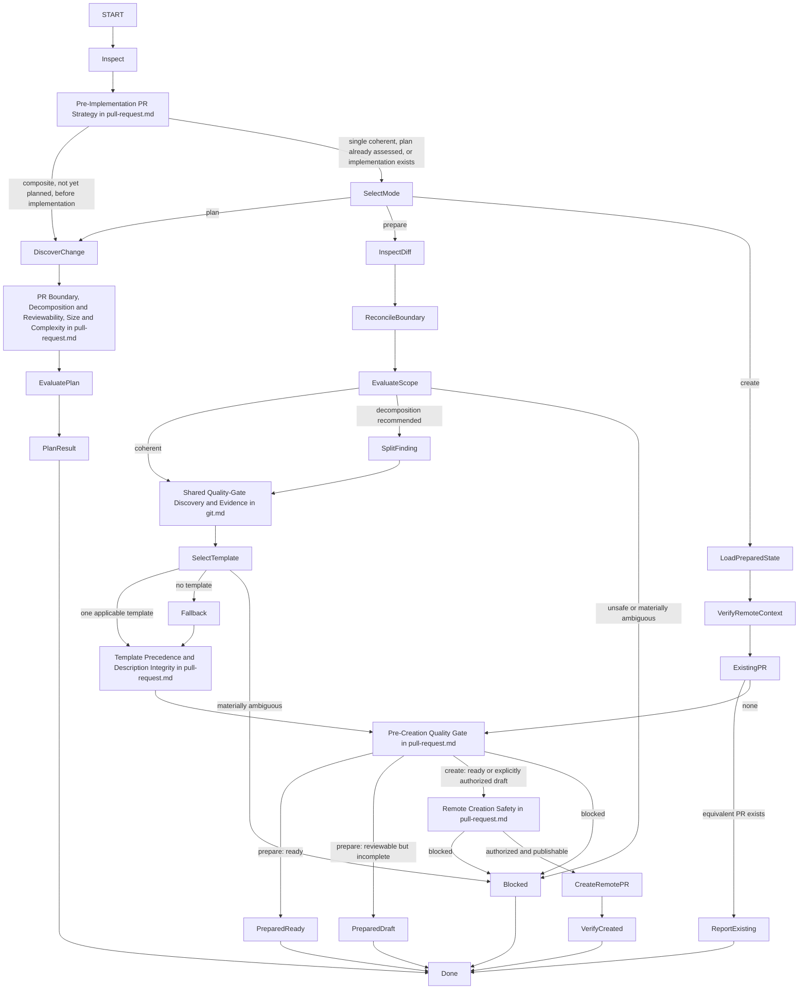

# Manage Pull Requests

## Purpose

Use to plan, prepare, or create pull requests while applying `contexts/git/rules/pull-request.md` and preserving repository safety, reviewability, traceability, and authorization boundaries.

This skill supports three modes:

* **plan** — decompose a larger change into one or more coherent PR boundaries;
* **prepare** — inspect an implemented change and produce a truthful review-ready title, description, readiness state, and scope findings;
* **create** — create the remote PR after preparation and explicit authorization.

## Uses

* Rule: `contexts/git/rules/git.md`
* Rule: `contexts/git/rules/pull-request.md`
* Rule: `contexts/git/rules/gitflow.md` when applicable
* Optional contract: `contracts/work-item.md`
* Optional contract: `contracts/test-basis.md`
* Optional input contract: `contracts/review-evidence.md`
* Optional contract: `contracts/test-evidence.md`

## Working State

Maintain, when relevant:

* mode: `plan`, `prepare`, or `create`;
* PR strategy for a multi-outcome request: the authorized increment, candidate single/independent/stacked boundaries, actual dependencies, and whether the assessment preceded implementation;
* repository and hosting-provider conventions;
* intended head and base;
* branch publication state and freshness when material;
* source requirement, rule, use case, scenario, work item, defect, or decision references;
* Product Slice, use-case slice, Architectural Slice, or other delivery-slice context when supplied;
* PR Boundary:
  * primary objective;
  * included changes;
  * excluded/deferred changes;
  * dependencies and ordering;
  * assigned scenarios, acceptance criteria, rules, invariants, or guarantees;
  * expected verification evidence;
  * compatibility, migration, security, privacy, data-integrity, financial-integrity, rollout, observability, and rollback concerns when material;
  * expected larger-scope state after merge;
* final diff and commit evidence when implemented;
* review-relevant size and complexity signals;
* applicable PR template and contribution instructions;
* per-check quality-gate inventory, effective hooks/CI, code identity, observed evidence and missing explicit executions (tests, lint, coverage when established);
* independent code-review verdict, review target identity and coverage, and known gaps;
* title and description;
* readiness: `ready`, `draft`, or `blocked`;
* remote PR identity and verified state after creation.

## Workflow

The diagram is the procedure. Apply the rule section named on each decision node. Do not restate it. For existing diffs, assess decomposition in `prepare` without claiming that pre-implementation planning occurred. A scoped request for one increment does not authorize implementing the entire roadmap.

## Decomposition Signals

Apply Decomposition and Reviewability and Size and Complexity in `contexts/git/rules/pull-request.md`.

## Output

### Plan mode

Produce:

* ordered PR boundaries;
* primary objective for each PR;
* included/excluded scope;
* dependencies and intended bases;
* traceability to supplied requirements/rules/scenarios/work items/slices;
* required verification and critical guarantees;
* size/complexity risks or decomposition rationale.

### Prepare mode

Produce:

* preparation state: `ready`, `draft`, or `blocked`;
* reconciled PR Boundary;
* scope/decomposition findings;
* applicable template source or fallback decision;
* proposed title;
* complete PR description;
* observed tests, lint, independent review verdict/coverage/identity, and limitations;
* material risks, dependencies, and remaining work.

### Create mode

Produce:

* remote PR identifier and URL/reference;
* verified head/base;
* verified draft/ready state;
* title and description used;
* preparation/verification summary including evidence origins, exact revision/scope, pre-creation independent review, tests, lint and established coverage;
* any remaining limitations or follow-up work.

## Boundaries

* Planning does not authorize implementation, branch creation, commits, pushes, or remote PR creation.
* Preparing does not authorize modifying production/test code, creating commits, pushing, creating/updating a remote PR, assigning reviewers, labeling, merging, or releasing.
* Creating authorizes only creation of the remote PR object described by the command. It does not authorize push, history rewrite, reviewer assignment, labels, milestones, auto-merge, merge, branch deletion, release, or deployment unless separately authorized.
* This skill may diagnose scope, test, implementation, or architecture defects, but diagnosis does not authorize changing those artifacts.
* Do not alter the final diff merely to make the PR description look coherent unless a separate implementation authorization exists.
* Readiness and what the description may claim are the Pre-Creation Quality Gate in `contexts/git/rules/pull-request.md`.
* Do not claim verification, readiness, publication, merge, release, or deployment states without corresponding evidence.

## Stop Conditions

Stop only the affected decision and report the blocker when:

* the intended base or head is materially ambiguous;
* repository instructions conflict and no precedence can be established;
* multiple PR templates are plausible and no selection rule exists;
* the diff cannot be reconciled with one coherent objective;
* integration would expose incomplete behavior without required safety guarantees;
* a ready-for-review request does not satisfy the Pre-Creation Quality Gate in `contexts/git/rules/pull-request.md`;
* critical verification required by repository policy is unavailable or failing;
* source intent is materially ambiguous and changes the PR boundary;
* secrets or sensitive data would be exposed;
* remote PR creation is requested but the head is not published and push is not authorized;
* an equivalent open PR already exists and creating another would be duplicative;
* continuing would require an unauthorized code, branch, history, push, merge, release, or deployment mutation.
