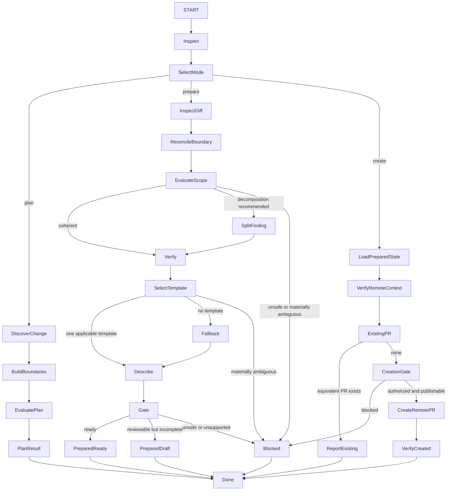

# Manage Pull Requests

## Purpose

Use to plan, prepare, or create pull requests while applying `contexts/git/rules/pull-request.md` and preserving repository safety, reviewability, traceability, and authorization boundaries.

This skill supports three modes:

* **plan** — decompose a larger change into one or more coherent PR boundaries;
* **prepare** — inspect an implemented change and produce a truthful review-ready title, description, readiness state, and scope findings;
* **create** — create the remote PR after preparation and explicit authorization.

## Uses

* Rule: `contexts/git/rules/git.md`
* Rule: `contexts/git/rules/pull-request.md`
* Rule: `contexts/git/rules/gitflow.md` when applicable
* Optional contract: `contracts/work-item.md`
* Optional contract: `contracts/test-basis.md`
* Optional input contract: `contracts/review-evidence.md`
* Optional contract: `contracts/test-evidence.md`

## Working State

Maintain, when relevant:

* mode: `plan`, `prepare`, or `create`;
* repository and hosting-provider conventions;
* intended head and base;
* branch publication state and freshness when material;
* source requirement, rule, use case, scenario, work item, defect, or decision references;
* Product Slice, use-case slice, Architectural Slice, or other delivery-slice context when supplied;
* PR Boundary:
  * primary objective;
  * included changes;
  * excluded/deferred changes;
  * dependencies and ordering;
  * assigned scenarios, acceptance criteria, rules, invariants, or guarantees;
  * expected verification evidence;
  * compatibility, migration, security, privacy, data-integrity, financial-integrity, rollout, observability, and rollback concerns when material;
  * expected larger-scope state after merge;
* final diff and commit evidence when implemented;
* review-relevant size and complexity signals;
* applicable PR template and contribution instructions;
* verification evidence (tests, lint, independent code-review verdict, review target identity and coverage) and known gaps;
* title and description;
* readiness: `ready`, `draft`, or `blocked`;
* remote PR identity and verified state after creation.

## Operational Graph

## Workflow

### 1. Inspect Context

For every mode:

1. Read the repository's contribution, branch, review, signing, and PR conventions before applying generic guidance.
2. Inspect only the smallest sufficient repository context first, then broaden investigation when evidence requires it.
3. Treat planning artifacts as optional evidence. Do not let a ticket or backlog description override the actual repository state or final diff.
4. Keep assumptions explicit. Do not invent source intent, identifiers, verification results, or workflow rules.

### 2. Plan Mode

Use when a change is larger than one obvious review unit or when PR boundaries should be designed before implementation.

1. Understand the larger change, Product Slice, use-case slice, work item, requirement, defect, or other source.
2. Identify the smallest coherent and verifiable delivery/review units that can remain safe after each merge.
3. Build one PR Boundary for each proposed PR.
4. Prefer vertical/use-case slicing when it preserves meaningful behavior and safe integration.
5. Use technical preparatory PRs when they independently reduce risk or enable later slices and remain traceable to the larger change.
6. Keep directly related tests with the corresponding behavior unless a prerequisite test or characterization change is itself the coherent unit.
7. Identify dependencies between PRs and whether they can be independent, sequential, or stacked.
8. Verify that decomposition does not postpone critical guarantees such as authorization, privacy, data integrity, idempotency, compliance, duplicate prevention, or minimum observability.
9. Assess size and complexity using the rule heuristics as signals, never as standalone acceptance criteria.
10. Produce an ordered PR plan. Do not modify branches, code, commits, or remotes in plan mode.

### 3. Prepare Mode

Use after implementation exists or when a branch/diff is ready to be inspected for review.

1. Determine the intended base from repository workflow and explicit task context. Do not assume `main` or `develop`.
2. Inspect the final diff, commits, branch state, and relevant repository instructions.
3. Reconstruct or load the PR Boundary and compare it to the implemented diff.
4. Identify:
   * unrelated or accidental changes;
   * missing changes required by the stated objective;
   * unplanned scope expansion;
   * behavior, contract, data, security, or operational risks;
   * dependencies on unmerged or unpublished work;
   * review-relevant size and complexity.
5. If decomposition would materially improve reviewability, propose the specific split and its boundaries. Do not mechanically split a coherent change solely to satisfy a line threshold.
6. Verify applicable scenarios, rules, acceptance criteria, invariants, and guarantees from available evidence.
7. Execute or inspect non-destructive, applicable project tests and lint when the invoked command authorizes it and the environment supports it; record exact results or justified non-applicability.
8. Obtain independent pre-PR review evidence via `contracts/review-evidence.md` when provided. If absent, request the separate read-only Review capability through an explicitly authorized orchestrator; do not invoke Review's internal agents/skills solely to fetch data. For local preparation, record missing, blocked or stale review explicitly; do not describe the result as fully ready.
9. Record only observed results. Keep failures, skipped checks, blocked checks, and unavailable verification explicit.
10. Search for the repository's applicable PR template and contribution instructions.
11. If one applicable template exists, preserve its structure. If multiple templates are materially ambiguous, stop the affected preparation decision rather than choosing arbitrarily.
12. If no applicable template exists, use the fallback structure from `contexts/git/rules/pull-request.md`.
13. Derive the title from the actual principal change and repository convention.
14. Write the description from the final diff and evidence:
    * why;
    * what;
    * validation;
    * impact;
    * traceability/slice contribution;
    * remaining work.
15. Determine readiness:
    * **ready** — the PR is coherent, safe to integrate, and sufficiently evidenced for review under repository policy, including independent review PASS and applicable tests/lint;
    * **draft** — preparation remains incomplete for final review; remote publication still requires all mandatory pre-creation checks;
    * **blocked** — creating/presenting the PR would be unsafe, materially misleading, or incompatible with repository policy.
16. Recheck that PR readiness is not being used as evidence that the larger task, Product Slice, story, deployment, or release is complete.

### 4. Create Mode

Use only when remote PR creation is explicitly authorized.

1. Require or perform the preparation checks needed to establish a truthful title, description, PR Boundary, and readiness state.
2. Verify:
   * remote repository identity;
   * intended head and base;
   * head publication state;
   * branch freshness when it affects correctness;
   * repository workflow;
   * whether an equivalent open PR already exists.
3. If the head branch is not published, do not push it unless push is separately authorized.
4. If an equivalent PR already exists, report/reuse it rather than creating a duplicate.
5. Revalidate the pre-creation quality gate against the final remote head/base: independent Code Review must have `PASS`, complete required coverage, and no unresolved blockers; applicable tests and lint must have current successful evidence (or documented genuine non-applicability). If evidence is missing, stale, failed or incomplete, do not create **any** remote PR, including a draft. When a runtime explicitly orchestrates cross-context work, it may obtain new read-only review evidence and retry this check without importing Review internals into Git.
6. Do not create a PR whose preparation state is `blocked`.
7. Create the PR as draft when preparation indicates `draft`, unless explicit repository/user direction requires another state and doing so remains truthful.
8. Create a ready-for-review PR only when preparation indicates `ready`.
9. Do not infer reviewers, labels, milestones, auto-merge, merge method, or release actions from PR creation alone.
10. After creation, fetch/inspect the remote PR and verify:
   * repository;
   * PR identity;
   * head/base;
   * title;
   * draft/ready state.
11. Report the remote PR state without claiming merge, deployment, release, or task completion.

## Decomposition Signals

A split deserves explicit consideration when one or more of these are true:

* the PR contains multiple independent behavioral objectives;
* unrelated feature, defect, cleanup, or refactoring changes are mixed;
* different changes have materially different rollback or risk profiles;
* the diff crosses many modules/services/bounded contexts without one coherent behavior;
* a migration/compatibility step must precede activation;
* the PR exceeds the project's normal review scale and a safe coherent split exists;
* reviewers would need materially different context for independent parts;
* a preparatory refactor can safely reduce the complexity of a later behavior change.

A large PR may remain one PR when splitting would make the change unsafe, incoherent, unverifiable, or substantially harder to understand. Record the reason.

## Output

### Plan mode

Produce:

* ordered PR boundaries;
* primary objective for each PR;
* included/excluded scope;
* dependencies and intended bases;
* traceability to supplied requirements/rules/scenarios/work items/slices;
* required verification and critical guarantees;
* size/complexity risks or decomposition rationale.

### Prepare mode

Produce:

* preparation state: `ready`, `draft`, or `blocked`;
* reconciled PR Boundary;
* scope/decomposition findings;
* applicable template source or fallback decision;
* proposed title;
* complete PR description;
* observed tests, lint, independent review verdict/coverage/identity, and limitations;
* material risks, dependencies, and remaining work.

### Create mode

Produce:

* remote PR identifier and URL/reference;
* verified head/base;
* verified draft/ready state;
* title and description used;
* preparation/verification summary including pre-creation independent review, tests and lint;
* any remaining limitations or follow-up work.

## Boundaries

* Planning does not authorize implementation, branch creation, commits, pushes, or remote PR creation.
* Preparing does not authorize modifying production/test code, creating commits, pushing, creating/updating a remote PR, assigning reviewers, labeling, merging, or releasing.
* Creating authorizes only creation of the remote PR object described by the command. It does not authorize push, history rewrite, reviewer assignment, labels, milestones, auto-merge, merge, branch deletion, release, or deployment unless separately authorized.
* This skill may diagnose scope, test, implementation, or architecture defects, but diagnosis does not authorize changing those artifacts.
* Do not alter the final diff merely to make the PR description look coherent unless a separate implementation authorization exists.
* Remote PR creation must not bypass independent code review, applicable tests or lint merely because the target is a draft. Absence of a specific review engine (including OCR) is not a justification to skip native review.
* Do not claim verification, readiness, publication, merge, release, or deployment states without corresponding evidence.

## Stop Conditions

Stop only the affected decision and report the blocker when:

* the intended base or head is materially ambiguous;
* repository instructions conflict and no precedence can be established;
* multiple PR templates are plausible and no selection rule exists;
* the diff cannot be reconciled with one coherent objective;
* integration would expose incomplete behavior without required safety guarantees;
* current independent review PASS, applicable test, or lint evidence is missing, stale, failed, or incomplete when remote creation is requested;
* critical verification required by repository policy is unavailable or failing;
* source intent is materially ambiguous and changes the PR boundary;
* secrets or sensitive data would be exposed;
* remote PR creation is requested but the head is not published and push is not authorized;
* an equivalent open PR already exists and creating another would be duplicative;
* continuing would require an unauthorized code, branch, history, push, merge, release, or deployment mutation.
