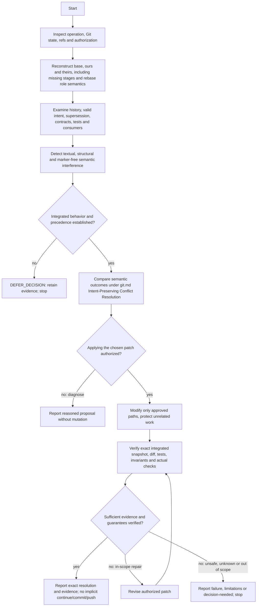

# Resolve Merge Conflicts

## Purpose

Diagnose interfering changes and, when explicitly authorized, apply the smallest evidence-backed resolution preserving valid integrated behavior. This Git capability neither replaces implementation/testing nor claims to perform independent Code Review.

## Uses

* Rule: `contexts/git/rules/git.md` (Intent-Preserving Conflict Resolution, Repository State, Conflict and Failure Handling, Shared Quality-Gate Discovery and Evidence).
* Optional contract: `contracts/requirements.md`.
* Optional contract: `contracts/test-basis.md`.
* Optional contract: `contracts/test-evidence.md`.
* Optional contract: `contracts/work-item.md`.

## Working State

Track operation type; separately approved diagnose/apply/stage/continue scope; repository refs, worktree/index fingerprint and unrelated changes; base/ours/theirs or missing stages; changed symbols and affected consumers; applicable requirements and source precedence; intended original, per-branch and integrated behavior; risk, invariants, alternatives, decisions, patch scope, checks and outstanding uncertainty.

## Workflow

The diagram is the procedure. The semantic outcome definitions and risk/safety invariants have one canonical owner in `contexts/git/rules/git.md`. Investigate further context only when it can affect a material integration decision.

## Decision Evidence

Report a lightweight, portable record without inventing a new cross-context contract:

* `operation/target`: merge/rebase/cherry-pick, affected files/symbols, verified refs and resolved snapshot/workspace fingerprint.
* `sources`: base/ours/theirs provenance, commits, requirements, decisions, consumers, tests, explicit supersession and unknown sources.
* `behavior`: previously valid behavior, intent per side, required integrated behavior and preserved/superseded invariants.
* `decision`: one justified semantic strategy, rejected alternatives and `decision-needed` questions when applicable.
* `verification`: actual check commands, target identity, scope and `passed` / `failed` / `not-run` / `blocked` / `stale` / justified `not-applicable` outcome, including interaction tests where material.
* `limitations`: unreviewed effects, remaining Git operation, authorization needed and unresolved risks.

The record is a recommendation or integration result, not a claim of an independent review gate.

## Output

Distinguish `diagnosed`, `patch-applied`, `verified`, `blocked` and `decision-needed`. Clearing markers or staging changes is not verification. State separate next steps and permission requirements.

## Boundaries

* Diagnosis is read-only. Edits and staging have separate explicit permissions and touch approved paths only.
* Do not modify unrelated code, fabricate domain precedence, erase existing work, install helpers, access unapproved services, or silently make business decisions.
* Do not continue an operation, create a commit, push, merge a PR, force-update refs, tag, release or deploy without separate authorization.
* Consume Requirements/Testing evidence through neutral contracts; do not invoke internal agents/skills of another context or claim independent review.
* Native Git/source analysis works without external merge tools. Optional structural merge engines and `rerere` never determine semantic correctness.

## Stop Conditions

Stop on material contradiction without precedence, unavailable essential Git context, unsafe or unauthorized mutation, failed required checks, unacceptable residual risk, or unproductive rework. Preserve the active operation; do not abort it without authorization.

