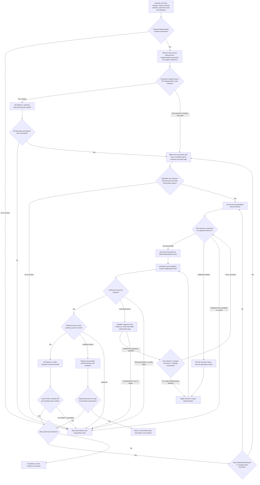

# Implement Slice

## Purpose

Implement one supported, independently verifiable code slice without silently modifying its requirement meaning or crossing its mutation boundary.

## Uses

* Rule: `contexts/implementation/rules/implementation.md`
* Skill: `contexts/implementation/skills/test-driven-development/SKILL.md`
* Optional input contract: `contracts/design-evidence.md`
* Optional input contract: `contracts/requirements.md`
* Optional input contract: `contracts/work-item.md`
* Optional input contract: `contracts/test-basis.md`
* Optional output contract: `contracts/test-evidence.md`
* Optional input diagnosis: `contracts/debugging-evidence.md`

## Working State

Keep the current authorized slice, source baseline, Change Boundary, and pre-edit intention partition (purposes, independent revert test, verification, safe intermediate states and dependency order). Track PR-plan status when material, repository state, commit authority and its source, Git handoff SHA, tests/checks, unresolved risks and external effects. Preserve external-effect identifiers when material to safe resumption.

## Workflow

Apply the named sections of `contexts/implementation/rules/implementation.md`. When TDD is selected, delegate its inner RED/GREEN/REFACTOR loop to `contexts/implementation/skills/test-driven-development/SKILL.md` rather than rewriting it here. Git owns semantic commit execution; Implementation supplies a completed in-scope intention and waits for verified Git evidence before selecting another intention when a local commit is permitted. Do not treat silence in an authorized implementation plan as missing commit authority. When TDD is selected, multiple RED/GREEN/REFACTOR cycles may complete the same intention **only if Git's separation test shows no separately verifiable/revertible outcome**; return here for integrated verification and Git handoff as soon as the intention is complete, before selecting another.

## Pre-Edit Atomic Intention Plan

The `Partition` gate precedes **all production and test edits**, including TDD RED. Before executing the first edit, identify each candidate intention by its purpose, expected observable change, verification, meaningful revert boundary, dependency order and a valid intermediate repository state. For a single clearly indivisible change, a brief one-item plan is sufficient. A PR plan or work item is not evidence that a card contains only one intention. When an unexpected independent change appears, preserve the current unit without mixing the new work, re-run the Git separation test and get the first intention verified/committed before editing the next. Do not use task-level commits or external TDD cadence to override Git atomicity.

## Test Strategy Selection

Before production edits, apply the **Test-Driven Execution** policy in `contexts/implementation/rules/implementation.md`. Prefer the existing TDD Skill for testable observable behavior without waiting for a TDD keyword. An explicit caller opt-out of TDD permits direct implementation but never waives applicable tests; otherwise use direct implementation only for a recorded concrete exception and alternative verification plan. Explicitly required TDD that cannot run safely stops the affected change. After diagnosis, reselect TDD when behavior or its test basis changes; only a repair to the same already-tested behavior may proceed without a fresh RED, with the original test evidence preserved. Neither path expands mutation or remote-operation authority.

### Failure diagnosis boundary

For a nontrivial or unexplained failure, use the canonical Debugging investigation **when it provides material information**; consume the resulting `contracts/debugging-evidence.md` as evidence, not mutation authority. Simple, already-evidenced local failures need no extra delegation. If expected behavior is unsupported, defer to Requirements; if the proposed repair changes a critical architectural contract, defer to Design. Only this authorized Implementation operation may edit production code and related tests. New source revisions or contrary observations require diagnostic revalidation; do not loop through speculative patches or assume a fixed retry count proves an architectural flaw.

## Cross-context Handoffs

* **Before mutation, if PR decomposition is material:** ask the Git Engineer to use `contexts/git/skills/manage-pull-request/SKILL.md` in read-only `plan` mode under `contexts/git/rules/pull-request.md`, unless a current plan already exists. Consume its PR Boundary, included/excluded scope, dependencies and intended base without granting additional implementation or publication authority.
* **After each verified intention:** recheck the staged change against the pre-edit reversible-intention partition and hand the Git Engineer the current atomic change boundary (including paths/hunks and unrelated-work exclusions), actual workspace/revision, observed checks and resolved effective local-commit authorization. Git applies `contexts/git/skills/create-semantic-commits/SKILL.md` and returns an observed commit SHA, exact committed scope, resulting repository status, or a blocker. Never perform an unverified substitute commit or count a requested handoff as a completed commit.
* **Explicitly prohibited local commits:** retain the verified intention as uncommitted evidence; do not automatically begin another intention without explicit safe-continuation authorization. A PR plan does not authorize a commit, push, PR creation or merge.

## Output

Return the bounded implementation state for a separate Integration stage; report the planned atomic intentions, verified commits or outstanding units without treating a task as a commit. Do not initiate Code Review, Git PR preparation/creation or merge as a side effect of completing this Skill. Report implementation files and affected interfaces, source and design references where available, verification commands and observed results, verified commit SHAs and resulting Git state when authorized and completed, or explicit uncommitted/blocked handoff status; PR-plan status when material; selected test strategy, concrete exception and alternative verification when TDD was skipped; residual risks and readiness. Use `contracts/test-evidence.md` for supported scenario coverage without inventing passed tests.

## Boundary

Only the expressly authorized source and test mutations for the selected slice. A missing or conflicting implementation mutation authorization blocks changes; do not infer it from a stage name. No implicit requirement approval, unrelated refactoring, push, PR creation, release, deploy, secrets access, destructive external operation, or claims of independent Review.

## Stop Conditions

Block the affected slice on unsupported acceptance semantics, missing material guarantees, unauthorized effects, unsafe repository state, failed/unverified required Git handoff, unproductive retries, or unavailable mandatory verification; preserve independently valid evidence.
