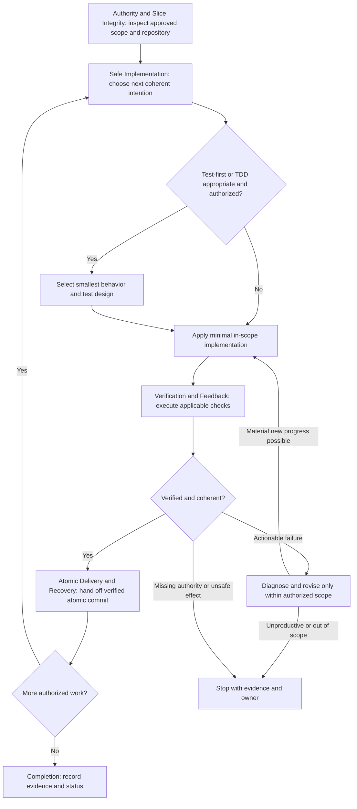

# Implement Slice

## Purpose

Implement one supported, independently verifiable code slice without silently modifying its requirement meaning or crossing its mutation boundary.

## Uses

* Rule: `contexts/implementation/rules/implementation.md`
* Skill: `contexts/implementation/skills/test-driven-development/SKILL.md`
* Optional input contract: `contracts/design-evidence.md`
* Optional input contract: `contracts/requirements.md`
* Optional input contract: `contracts/work-item.md`
* Optional input contract: `contracts/test-basis.md`
* Optional output contract: `contracts/test-evidence.md`

## Working State

Keep the current authorized slice, source baseline, Change Boundary, affected files, repository state, tests, intended checks, relevant decisions, unresolved risks, retry history, and observed outcomes. Preserve external-effect identifiers when material to safe resumption.

## Workflow

Apply the named sections of `contexts/implementation/rules/implementation.md`. When TDD is selected, delegate its inner RED/GREEN/REFACTOR loop to `contexts/implementation/skills/test-driven-development/SKILL.md` rather than rewriting it here. Git owns semantic commit execution; Implementation supplies the completed in-scope intention.

## Output

Report implementation files and affected interfaces, source and design references where available, verification commands and observed results, commit references when authorized and completed, residual risks and readiness. Use `contracts/test-evidence.md` for supported scenario coverage without inventing passed tests.

## Boundary

Only the expressly authorized source and test mutations for the selected slice. No implicit requirement approval, unrelated refactoring, push, PR creation, release, deploy, secrets access, destructive external operation, or claims of independent Review.

## Stop Conditions

Block the affected slice on unsupported acceptance semantics, missing material guarantees, unauthorized effects, unsafe repository state, unproductive retries, or unavailable mandatory verification; preserve independently valid evidence.
