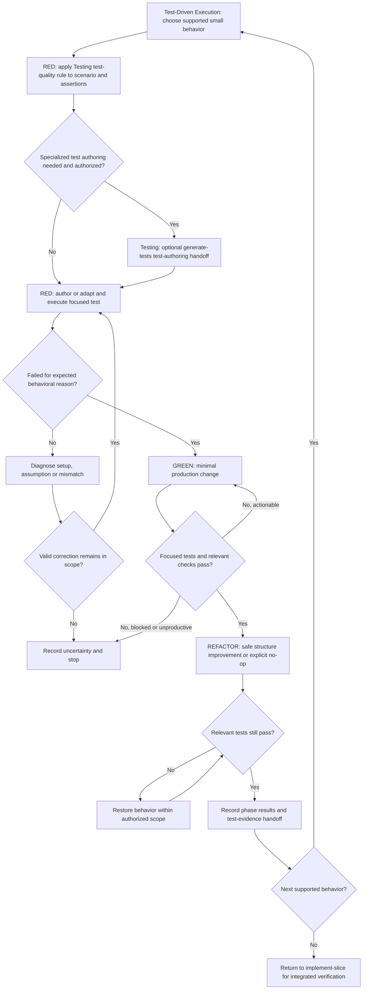

# Test-Driven Development

## Purpose

Guide implementation through one small executable behavior at a time with verifiable RED, GREEN and REFACTOR evidence when TDD is selected.

## Uses

* Rule: `contexts/implementation/rules/implementation.md`
* Optional input contract: `contracts/test-basis.md`
* Optional output contract: `contracts/test-evidence.md`
* Optional input contract: `contracts/design-evidence.md`

## Working State

Preserve the authorized slice, selected behavior and scenario identity when present, test and production change scope, current source revision, commands/results at each phase, newly discovered risks, and unresolved decisions.

## Workflow

The workflow implements `contexts/implementation/rules/implementation.md` sections **Test-Driven Execution** and **Verification and Feedback**; the rule owns TDD phase invariants. Apply `contexts/testing/rules/testing.md` as the **canonical test-quality reference** in RED, including relevant observable assertions, test isolation, determinism, scenario traceability and test-level selection, without copying its procedure here.

## RED Test-Authoring Handoff

* **Default:** Implementation authors the smallest supported behavioral test under the Testing rule and executes it. A legitimate RED is an **observed failure for the expected behavioral reason**; an already-passing test, an environmental/setup failure or a weakened assertion is not valid RED evidence.
* **Conditional composition:** when specialized test design or authoring materially helps and the caller's authorized scope and host permit cross-context routing, request `contexts/testing/skills/generate-tests/SKILL.md` through the Testing specialist for **test-artifact design/authoring only**, using `contracts/test-basis.md` or equivalent accepted behavior, scenario IDs, risk boundaries and applicable rules. This is not a mandatory delegation for every TDD cycle.
* **Handoff boundary:** Testing may propose or author **only authorized test files** and report traceability, uncertainty, executed checks and their actual outcomes. The requested behavior is deliberately not implemented yet; communicate that a focused, expected RED is not a defect to fix by relaxing assertions or changing behavior. A standalone Testing workflow may report incomplete/failing verification; do not reinterpret that as a GREEN success or suppress it to satisfy its ordinary completion criteria.
* **Implementation owns the loop:** after optional handoff, Implementation inspects the test against authoritative behavior and Testing quality rules, **executes or verifies RED** and diagnoses the failure before any GREEN production edit. Testing does not own GREEN, REFACTOR, production edits, TDD phase advancement, independent Review or Git actions. If routing is unavailable or would conflict with the intentional RED, follow the native rule-driven path without inventing a specialist invocation.
* Return control to the owning `implement-slice` workflow for integrated verification and atomic Git commit handoff. Do not make RED pass by redefining an accepted specification or inventing missing acceptance semantics.

## Output

Observed RED cause, GREEN passing tests, REFACTOR verification, code/test changes, related scenario identifiers where available, relevant commands and results, incomplete work or blockers. Preserve `contracts/test-evidence.md` semantics; do not label unrun or failed tests passed.

## Boundary

Only test and production edits within the authorized Implementation slice; no upstream requirement approvals, unrelated refactoring, independent Review verdict, Git push, PR publication, deployment or unapproved external side effect.

## Stop Conditions

Stop when the expected behavior is ambiguous, RED cannot be demonstrated for its expected reason, required verification is unavailable, retry has no new progress, or the next fix requires unapproved scope or side effects.
