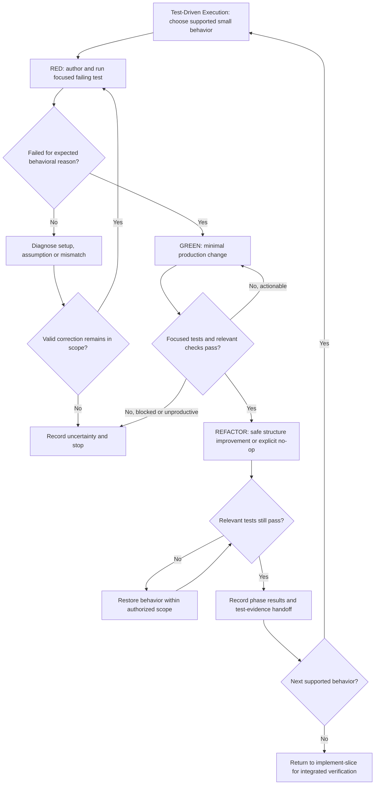

# Test-Driven Development

## Purpose

Guide implementation through one small executable behavior at a time with verifiable RED, GREEN and REFACTOR evidence when TDD is selected.

## Uses

* Rule: `contexts/implementation/rules/implementation.md`
* Optional input contract: `contracts/test-basis.md`
* Optional output contract: `contracts/test-evidence.md`
* Optional input contract: `contracts/design-evidence.md`

## Working State

Preserve the authorized slice, selected behavior and scenario identity when present, test and production change scope, current source revision, commands/results at each phase, newly discovered risks, and unresolved decisions.

## Workflow

The workflow implements `contexts/implementation/rules/implementation.md` sections **Test-Driven Execution** and **Verification and Feedback**; the rule is the single source for invariants. Return control to the owning Implementation workflow for holistic verification and atomic commit handoff. Do not make the RED test pass by redefining a governing specification.

## Output

Observed RED cause, GREEN passing tests, REFACTOR verification, code/test changes, related scenario identifiers where available, relevant commands and results, incomplete work or blockers. Preserve `contracts/test-evidence.md` semantics; do not label unrun or failed tests passed.

## Boundary

Only test and production edits within the authorized Implementation slice; no upstream requirement approvals, unrelated refactoring, independent Review verdict, Git push, PR publication, deployment or unapproved external side effect.

## Stop Conditions

Stop when the expected behavior is ambiguous, RED cannot be demonstrated for its expected reason, required verification is unavailable, retry has no new progress, or the next fix requires unapproved scope or side effects.
