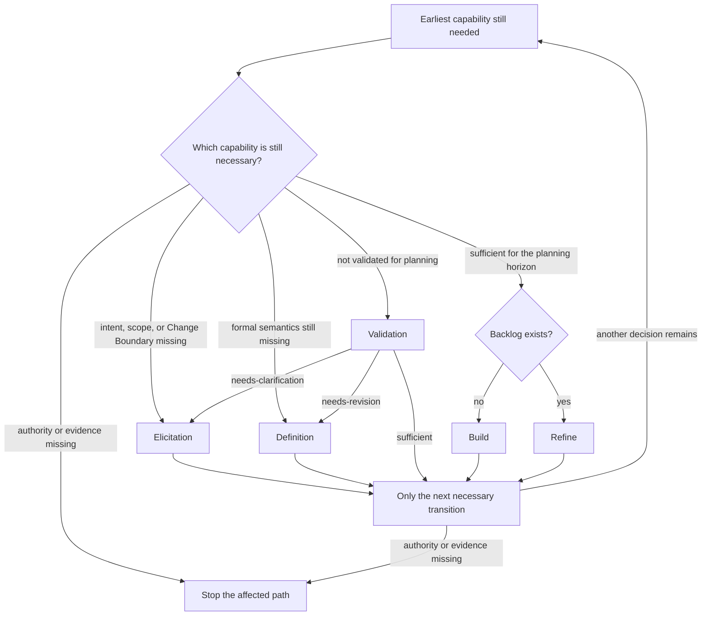

# Specify and Plan Change

## Intent

Specify and plan a feature, defect, correction, migration, regulatory change, operational improvement, or other bounded change using only the Requirements work needed for a validated planning handoff.

## Invocation

This is an optional composite Requirements entry point. It conditionally routes the existing elicitation, definition, read-only validation, and backlog-planning capabilities according to the evidence already available.

Invocation does not authorize architecture selection, implementation, automated-test generation, repository mutation, or Git operations.

## Uses

* Rule: `contexts/requirements/rules/tailoring.md`
* Rule: `contexts/requirements/rules/requirements.md`
* Rule: `contexts/requirements/rules/backlog.md`
* Agent: `contexts/requirements/agents/requirements-elicitor.md`
* Agent: `contexts/requirements/agents/requirements-specifier.md`
* Agent: `contexts/requirements/agents/backlog-planner.md`
* Skill: `contexts/requirements/skills/elicitation/SKILL.md`
* Skill: `contexts/requirements/skills/definition/SKILL.md`
* Skill: `contexts/requirements/skills/validation/SKILL.md`
* Skill: `contexts/requirements/skills/backlog-planning/SKILL.md`
* Contract: `contracts/requirements.md`
* Contract: `contracts/work-item.md`

## Inputs

* The requested change or problem context.
* Available stakeholder, product, domain, project, or existing-system evidence.
* Existing elicitation or requirement artifacts when present.
* Existing backlog when refinement rather than initial planning is intended.
* Intended planning horizon or next material decision when known.
* Existing Change Boundary, scope decisions, or applicable local requirements representation when present.
* Optional known security, privacy, compliance, migration, financial, or assurance constraints.

### Routing

The diagram selects existing capabilities. Each specialist keeps its own procedure. This command does not reimplement it.

Batch size follows `contexts/requirements/rules/tailoring.md`. Preserve identifiers, provenance, Change Boundary, lifecycle claims, and any known baseline/semantic-change/impact evidence across handoffs. Do not treat a proposed requirement revision as an accepted baseline or mark unknown downstream consumers current. Do not repair a specification under validation authority. A material Change Boundary change needs an explicit scope decision.

## Output

Return the smallest useful set of outputs actually produced by the routed capabilities, which may include:

* elicitation evidence conforming to `contracts/requirements.md`;
* requirement specification and read-only validation findings;
* explicit lifecycle/readiness state for the intended downstream target;
* `contracts/work-item.md`-compatible backlog items or refinements;
* unresolved questions, assumptions, options, conflicts, blockers, and recommended next evidence.

Do not manufacture empty intermediate artifacts merely to demonstrate that every stage was visited.

## Boundary

This command routes existing Requirements capabilities at invocation level; it does not redefine their semantics or take ownership of agent-level orchestration.

It must not:

* invent stakeholder intent to keep the pipeline moving;
* bypass a material validation finding;
* silently change requirement semantics or the Change Boundary during planning;
* select architecture or implementation;
* generate or repair production code;
* create automated tests;
* mutate a repository or perform Git operations.

A downstream mutation requires its own explicit command or separate authorization.
