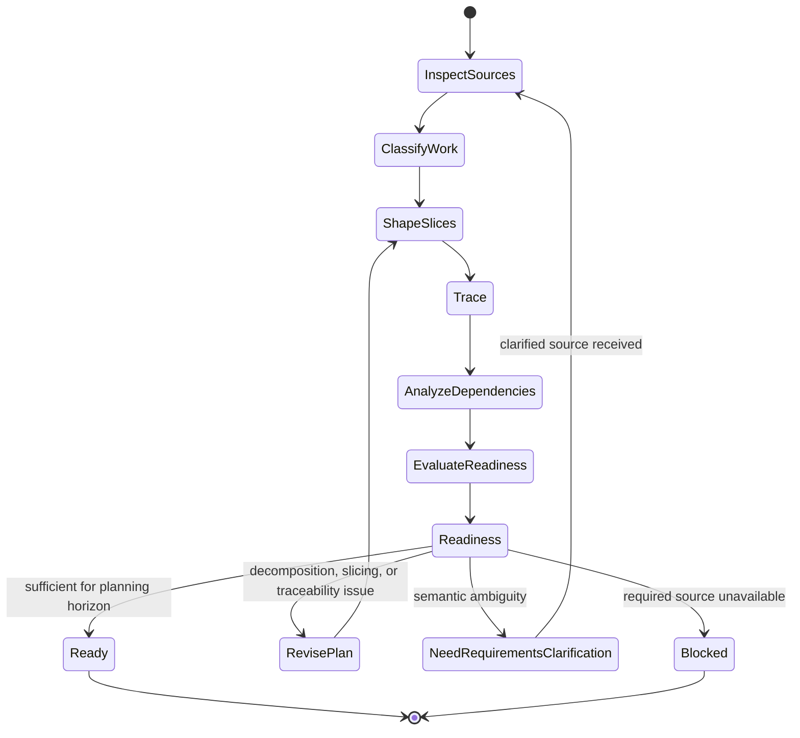

# Backlog Planning

## Purpose

Use to transform sufficiently defined requirements and other supported work sources into a structured, traceable backlog with decomposition and slicing proportional to the context, without silently changing source semantics.

## Uses

* Rule: `contexts/requirements/rules/tailoring.md`
* Rule: `contexts/requirements/rules/requirements.md`
* Rule: `contexts/requirements/rules/backlog.md`
* Contract: `contracts/requirements.md`
* Contract: `contracts/work-item.md`

## Modes

### Build

Create planning items from sufficiently specified source material.

### Refine

Improve an existing backlog while preserving requirement semantics and traceability.

Both modes use the same decomposition and validation workflow. Refinement is not a separate source of requirements.

## State Model

## Workflow

Follow the State Model.

Apply `contexts/requirements/rules/backlog.md` for slicing, traceability, and closure. Do not change requirement semantics; that authority stays in `contexts/requirements/rules/requirements.md`.

## Output

Produce `contracts/work-item.md`-compatible items with coherent intent, source traceability, Change Boundary reference when applicable, acceptance evidence, slice/learning context when applicable, use-case or journey context when known, dependencies, risks, assumptions, critical guarantees, and readiness state. Keep work-item readiness distinct from requirements validation, implementation, acceptance, deployment, release, and outcome completion.

Include closure findings and candidates for learning, trimming, deferment, or removal without silently deciding their disposition.

Do not invent priority, estimates, owners, iterations, deadlines, or product decisions.

## Stop Conditions

Stop only the affected planning decision and surface the issue when:

* decomposition or slicing would require inventing or materially changing source semantics or expanding/narrowing the Change Boundary without authority;
* a source conflict or unresolved requirement ambiguity changes item scope, acceptance, critical guarantees, or dependency structure;
* a required slice would be unsafe or invalid without a guarantee that has not been defined;
* an apparently required task would prematurely encode an unsupported design decision;
* required planning evidence is unavailable;
* repeated refinement is not reducing a material traceability, dependency, slicing, or readiness problem.
