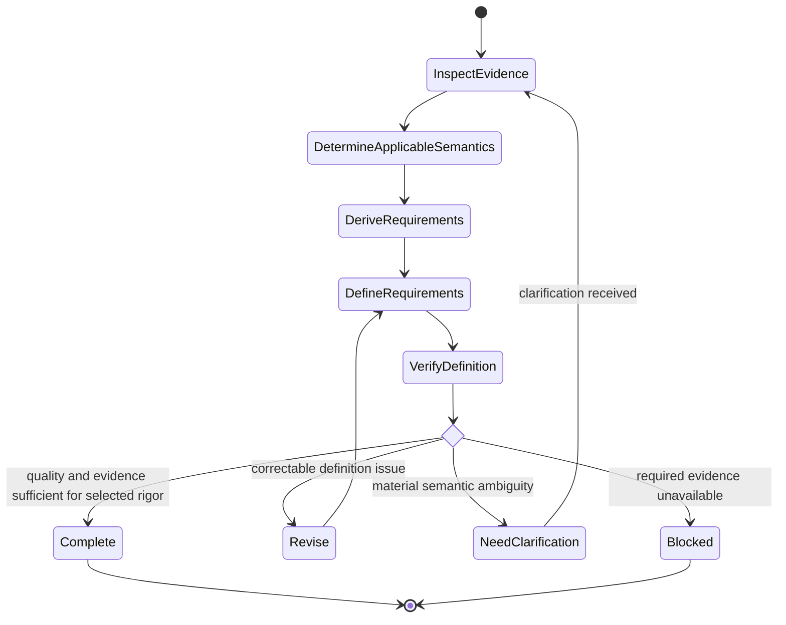

# Requirements Definition

## Purpose

Use to transform sufficiently understood needs and evidence into precise, verifiable, traceable requirements with rigor proportional to the context and without inventing missing stakeholder intent.

## Uses

* Rule: `contexts/requirements/rules/tailoring.md`
* Rule: `contexts/requirements/rules/requirements.md`
* Skill (conditional): `contexts/requirements/skills/example-discovery/SKILL.md`
* Contract: `contracts/requirements.md`
* Optional handoff: `contracts/test-basis.md`

## State Model

## Workflow

Follow the State Model.

Apply Requirement Quality and the applicable semantics sections in `contexts/requirements/rules/requirements.md`. Apply `contexts/requirements/rules/tailoring.md` when rigor is unset. When scenarios need dedicated exploration, use `contexts/requirements/skills/example-discovery/SKILL.md`. Do not restate those sources.

## Output

Produce a `contracts/requirements.md`-compatible specification containing the applicable strategic traceability, Change Boundary and supported boundary revisions when used, requirements, rules, constraints, acceptance/fit evidence, scenarios, assumptions, options, dependencies, conflicts, local representation convention when applicable, and unresolved questions. When a portable Scenario Set is useful for downstream behavioral verification, expose it through `contracts/test-basis.md` while preserving the same scenario identities.

Do not create fields merely to satisfy a schema when the corresponding knowledge is not relevant.

## Stop Conditions

Stop the affected definition decision and surface the issue when:

* evidence supports multiple materially different requirement interpretations;
* a required threshold, actor, policy, boundary, security obligation, data semantic, or acceptance meaning is unsupported;
* source conflicts require stakeholder or developer authority to resolve;
* a material scope change cannot be reconciled with the current Change Boundary without additional authority;
* continuing would require converting a design preference into stakeholder intent;
* required evidence is unavailable and the affected requirement cannot be meaningfully defined without it.
