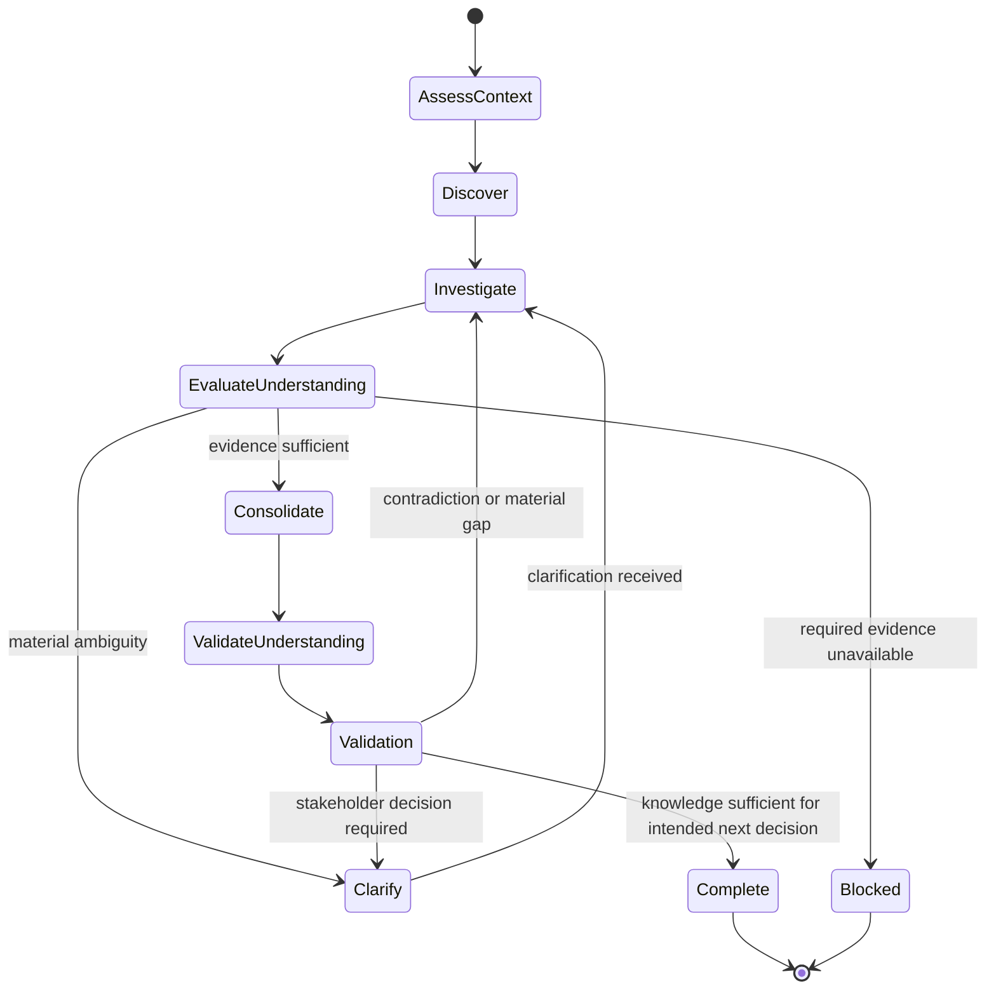

# Requirements Elicitation

## Purpose

Use to discover and structure the knowledge needed to understand a change before formal specification, applying only the rigor justified by its risk and uncertainty.

## Uses

* Rule: `contexts/requirements/rules/tailoring.md`
* Rule: `contexts/requirements/rules/requirements.md`
* Contract: `contracts/requirements.md`

## State Model

## Working State

Maintain only the concerns that are material to the context, including when relevant:

* selected rigor: `lightweight`, `standard`, or `high-assurance`, with rationale;
* applicable and explicitly non-applicable knowledge concerns;
* need, business goals, desired outcomes, and success evidence;
* current state, future state, and material change gaps;
* work scope, product/software boundary, and Change Boundary when useful;
* intended next decision or handoff and the smallest coherent knowledge batch needed to support it;
* material scope discoveries classified as clarification, boundary expansion/narrowing, separate change candidate, or missing critical guarantee;
* applicable local requirements template/schema/notation when one exists;
* stakeholders, affected actors, and relevant authority;
* business events and business responses;
* domain terms, facts, business rules, and external constraints;
* candidate solutions or learning options when solution uncertainty matters;
* transition needs for migration, rollout, compatibility, cutover, training, or decommissioning;
* risks, dependencies, assumptions, unknowns, options, conflicts, and provenance;
* open questions and decisions required.

## Workflow

Follow the State Model.

* AssessContext applies `contexts/requirements/rules/tailoring.md`.
* Discover through Consolidate apply Strategic Framing, Scope and Solution Boundary, Change Boundary and Scope Drift, and Business Knowledge and Rules in `contexts/requirements/rules/requirements.md`.
* Do not restate those sections.

## Output

Produce an elicitation handoff conforming to `contracts/requirements.md`. Include the selected rigor and applicable concerns when material, plus supported strategic framing, Change Boundary and material scope changes when used, stakeholder/domain knowledge, constraints, risks, assumptions, options, conflicts, provenance, local representation convention when applicable, and open questions.

Do not silently convert unresolved intent into formal requirements, architecture, backlog items, or software scope.

## Stop Conditions

Stop only the affected line of work and surface the issue when:

* a materially required stakeholder perspective or authoritative source is unavailable;
* conflicting evidence cannot be resolved within the authorized interaction;
* continuing would require inventing material stakeholder intent;
* product/software scope would have to be assumed without evidence;
* the requested scope exceeds the available authority or evidence;
* a material Change Boundary expansion or narrowing requires authority that is not available;
* repeated clarification or discovery attempts are not producing useful learning.
