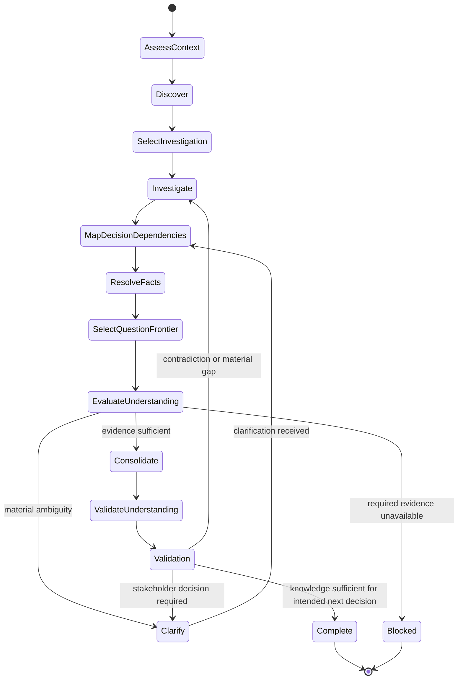

# Requirements Elicitation

## Purpose

Use to discover and structure the knowledge needed to understand a change before formal specification, applying only the rigor justified by its risk and uncertainty.

## Uses

* Rule: `contexts/requirements/rules/tailoring.md`
* Rule: `contexts/requirements/rules/requirements.md`
* Contract: `contracts/requirements.md`

## State Model

## Working State

Maintain only the concerns that are material to the context, including when relevant:

* selected rigor: `lightweight`, `standard`, or `high-assurance`, with rationale;
* applicable and explicitly non-applicable knowledge concerns;
* need, business goals, desired outcomes, and success evidence;
* current state, future state, and material change gaps;
* work scope, product/software boundary, and Change Boundary when useful;
* intended next decision or handoff and the smallest coherent knowledge batch needed to support it;
* material scope discoveries classified as clarification, boundary expansion/narrowing, separate change candidate, or missing critical guarantee;
* applicable local requirements template/schema/notation when one exists;
* stakeholders, affected actors, and relevant authority;
* business events and business responses;
* domain terms, facts, business rules, and external constraints;
* candidate solutions or learning options when solution uncertainty matters;
* transition needs for migration, rollout, compatibility, cutover, training, or decommissioning;
* risks, dependencies, assumptions, unknowns, options, conflicts, and provenance;
* open questions and decisions required;
* when material, a transient decision map: each decision's prerequisites, source/authority, current resolution, impact on the next handoff, and questions unblocked by its resolution.

## Workflow

Follow the State Model.

* AssessContext applies `contexts/requirements/rules/tailoring.md`.
* Discover through Consolidate apply Strategic Framing, Scope and Solution Boundary, Change Boundary and Scope Drift, and Business Knowledge and Rules in `contexts/requirements/rules/requirements.md`.
* SelectInvestigation applies Problem Investigation and Decision Evidence from that rule and the conditional technique selection below. Investigate may proceed without a named technique.
* Do not restate those sections.
* MapDecisionDependencies through SelectQuestionFrontier apply the protocol below; it is an elicitation procedure, not a second source of business rules.

### Contextual investigation selection

Select only an approach that can change a material interpretation, evidence need, option comparison, risk, or next question. These are optional techniques, not a checklist or a mandatory sequence.

| Decision-relevant signal | Useful technique | Investigative result |
| --- | --- | --- |
| A symptom has an uncertain or contested cause | Fishbone (Ishikawa) or five whys where a causal chain is plausible | Competing causal hypotheses, counterevidence, and facts still needed; no asserted root cause without evidence |
| A proposed solution rests on hidden assumptions, or the problem breakdown may be incomplete | First principles; MECE as a coverage/overlap diagnostic | Supported constraints versus assumptions, meaningful gaps and overlaps without forcing false exclusivity |
| Several viable solutions or learning approaches require comparison | Decision matrix or cost-benefit reasoning, combining them only when necessary | Sourced criteria, known trade-offs, uncertain costs/benefits, and the decision authority; no invented weights or ranking |
| Failure could be consequential or hard to reverse | Pre-mortem | Plausible failure paths, critical guarantees, and verification or mitigation questions |
| A high-impact claim is uncertain but can be investigated | Hypothesis testing | Falsifiable claim, observable signal, proposed learning method, and decision it would inform; no claim that an experiment ran |
| Evidence already supports the next decision at the selected rigor | No specialized technique | Proceed to the decision frontier without analysis ceremony |

Use techniques in combination only when each resolves a distinct material uncertainty. After investigation, re-evaluate what remains unknown and stop when further analysis cannot change the next decision without new evidence or authority. Preserve proposed tests or experiments as learning options; elicitation alone does not authorize execution.

### Decision-frontier interview protocol

1. **Expose material decisions.** Map only decisions that could change the current Need, Change Boundary, requirement meaning, critical guarantee, or intended next handoff. For each, distinguish verifiable facts, stakeholder-authority decisions, unresolved assumptions, and conditional branches; record prerequisite relationships only when material. Do not manufacture a full decision tree for trivial changes.
2. **Resolve facts before questioning.** Inspect supplied evidence and accessible context to settle factual prerequisites, citing provenance. A missing authoritative business decision is not a fact the agent may infer. If a source cannot be inspected, retain that uncertainty rather than calling the fact settled.
3. **Choose the decision frontier.** A question is eligible only when its prerequisite facts and decisions are settled. Two questions may share a round only if answering one cannot change whether, or how, the other should be asked. Prioritize pivots that reshape the next material decision; defer dependent, speculative, low-impact, or out-of-boundary questions.
4. **Ask proportionally.** For each selected stakeholder question, state why the answer changes the next decision and present relevant options/trade-offs. Recommend an option only when supported by evidence, label it as a recommendation, and wait for authorized confirmation. Group independent questions when that reduces interaction cost; ask sequentially when answers are dependent or cognitively demanding.
5. **Recompute after each answer or new source.** Update the dependency map, decisions, provenance and any affected Change Boundary proposal. Reopen a previously settled decision when contradictory evidence emerges. Do not silently decide a downstream question whose prerequisites changed.
6. **Stop on sufficiency, not exhaustive interviewing.** Exit when the next material decision is safely supported at the selected rigor; retain explicit unresolved or deferred branches. A missing critical guarantee, conflicting authority, or material semantic ambiguity blocks only the affected path. Follow existing Stop Conditions rather than forcing all branches of the tree to be answered.

The decision-tree/frontier technique draws on [Matt Pocock's grilling skill](https://github.com/mattpocock/skills/blob/main/skills/productivity/grilling/SKILL.md); the toolkit's tailoring, scope authority and stop criteria remain canonical.

## Output

Produce an elicitation handoff conforming to `contracts/requirements.md`. Include the selected rigor and applicable concerns when material, plus supported strategic framing, Change Boundary and material scope changes when used, stakeholder/domain knowledge, constraints, risks, assumptions, options, conflicts, provenance, local representation convention when applicable, and open questions.

Do not silently convert unresolved intent into formal requirements, architecture, backlog items, or software scope.

## Stop Conditions

Stop only the affected line of work and surface the issue when:

* a materially required stakeholder perspective or authoritative source is unavailable;
* conflicting evidence cannot be resolved within the authorized interaction;
* continuing would require inventing material stakeholder intent;
* product/software scope would have to be assumed without evidence;
* the requested scope exceeds the available authority or evidence;
* a material Change Boundary expansion or narrowing requires authority that is not available;
* repeated clarification or discovery attempts are not producing useful learning.
