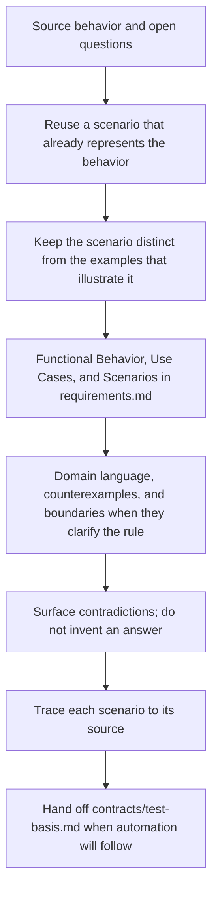

# Example Discovery

## Purpose

Use when scenarios and concrete examples are needed to refine shared understanding of a requirement, rule, use case, or planned slice before test automation.

This skill supports Example Mapping, Specification by Example, and BDD-oriented behavioral discovery without requiring Gherkin, a BDD framework, or the Testing context.

## Uses

* Rule: `contexts/requirements/rules/requirements.md`
* Rule: `contexts/requirements/rules/tailoring.md`
* Contract: `contracts/requirements.md`
* Optional handoff: `contracts/test-basis.md`

## Working State

Maintain, when relevant:

* source requirement, rule, use case, scenario, or slice;
* a Scenario Set with stable scenario identities;
* domain language and applicable business rules;
* scenario context, preconditions, trigger/action, and expected outcomes;
* concrete examples;
* counterexamples;
* boundary examples;
* open questions revealed by scenarios/examples;
* assumptions and unresolved conflicts;
* traceability to the source behavior.

## Scenario Identity

When scenarios are material:

* assign a stable `scenario_id` within the current scenario set;
* preserve an existing scenario identifier instead of generating a replacement;
* keep identifiers independent from Gherkin line numbers, test names, filenames, classes, methods, or test-framework identifiers;
* do not fabricate identifiers from an external tracker or requirements system;
* when an upstream artifact already owns scenario identity, reuse it exactly.

The identifier exists to preserve semantic traceability across representations, not to prescribe serialization.

## Workflow

The diagram is the procedure. Apply `contexts/requirements/rules/requirements.md` and `contexts/requirements/rules/tailoring.md`. The handoff shape is `contracts/test-basis.md`.

## Output

Produce, when scenarios are material, a `contracts/test-basis.md`-compatible Scenario Set containing:

* stable scenario identities;
* source references;
* behavioral intent and useful dimensions;
* context/preconditions;
* trigger/action;
* expected outcomes;
* applicable rules/invariants;
* examples, counterexamples, and boundaries;
* assumptions, risks, and open questions.

The output may contribute to acceptance evidence or a test basis, but it does not itself authorize creating tests or implementation changes.

## Stop Conditions

Stop only the affected scenario/example decision and surface the issue when:

* scenarios reveal materially different plausible behaviors that require stakeholder authority;
* a threshold, rule, precondition, outcome, or guarantee needed to define the behavior is unsupported;
* examples would require inventing business semantics;
* an existing scenario identity conflicts with another artifact and the authoritative source cannot be determined;
* the source requirement, use case, or slice is too immature to describe coherently.
