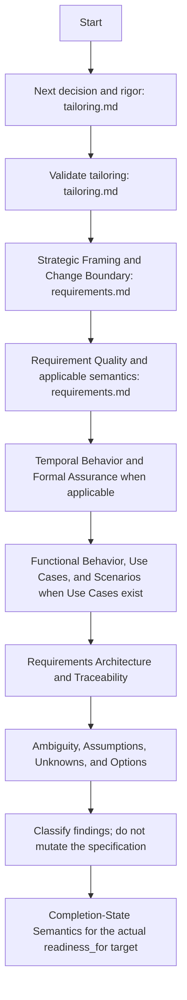

# Requirements Validation

## Purpose

Use as a read-only quality gate for requirements knowledge before a downstream decision. Evaluate whether the available knowledge is sufficiently correct, coherent, traceable, and verifiable for the intended next step at the selected rigor.

Do not judge quality by document count.

## Uses

* Rule: `contexts/requirements/rules/tailoring.md`
* Rule: `contexts/requirements/rules/requirements.md`
* Contract: `contracts/requirements.md`

## Finding Taxonomy

Classify each material finding by what was discovered:

* `defect` — the specification contradicts supported evidence, its own semantics, or an applicable rule and an evidence-backed revision can be described without inventing stakeholder intent;
* `ambiguity` — multiple materially different interpretations remain plausible;
* `gap` — knowledge required for the intended downstream use is absent;
* `conflict` — supported sources, requirements, rules, or decisions disagree;
* `risk` — the knowledge remains usable but carries material uncertainty, dependency, feasibility concern, or consequence that must stay visible;
* `waste` — representation or process appears duplicative, unused, prematurely detailed, or disproportionate to the decision and risk.

Missing documentation is not automatically a `gap`; first determine whether the required knowledge is represented elsewhere.

## Finding Severity

Classify impact independently from finding type:

* `critical` — substantial risk of building the wrong thing, financial harm, security/privacy/compliance breach, data loss, or a fundamental contradiction;
* `high` — significant risk of major rework, divergent interpretation, unsuitable architecture, lost value, or inability to validate;
* `medium` — important improvement, but work may proceed with the issue visible;
* `low` — clarity or maintainability refinement;
* `info` — observation or future opportunity.

Severity is not a confidence score.

## Workflow Status

Classify the overall result independently from individual findings:

* `sufficient` — no material issue blocks the intended downstream use at the selected rigor;
* `needs-revision` — one or more evidence-backed revisions are required before the intended downstream use;
* `needs-clarification` — stakeholder or developer input is required;
* `blocked` — required evidence or validation capability is unavailable.

Report the downstream target separately as `readiness_for`.

## Workflow

The diagram is the procedure. Apply the named section of `contexts/requirements/rules/requirements.md` or `contexts/requirements/rules/tailoring.md`. Do not restate it.

## Output

Produce a concise validation report containing:

* selected or assessed rigor and rationale when material;
* overall `status` and `readiness_for`;
* applicable concerns evaluated;
* findings with type, severity, affected identifiers, evidence, impact, and remediation;
* cross-artifact contradictions, drift, duplication, orphan relationships, and material Change Boundary mismatches when present;
* missing **knowledge**, not merely missing documents;
* for material temporal properties: ambiguous event/clock/boundary semantics, model assumptions, and whether any formal finding is supported by executed tool evidence rather than prose alone;
* premature solution decisions and implicit assumptions when present;
* evidence-backed revision recommendations;
* unresolved questions/decisions and evidence needed to resolve them;
* prioritized actions, distinguishing blockers from improvements that can proceed incrementally.

## Boundary

Validation is read-only unless a separate command or explicit authorization permits modifying the specification or another artifact. A model-checker or FRET adapter is not a prerequisite: when absent, report formal analysis as not executed rather than calling a semantic review a proof. This skill may describe an evidence-backed revision but must not apply it silently.

## Stop Conditions

Stop only the affected validation decision and surface the issue when:

* a material ambiguity, gap, or conflict requires authority not available to the validator;
* required source evidence cannot be obtained or inspected;
* validation would require inventing expected semantics;
* the selected rigor cannot be justified and that uncertainty changes readiness;
* repeated validation cycles are not reducing the material findings;
* a downstream-readiness conclusion cannot be supported by evidence.
