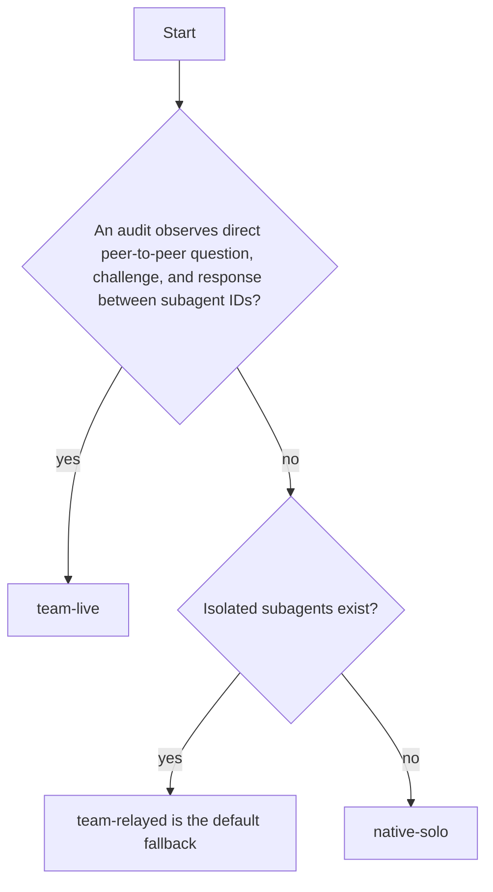
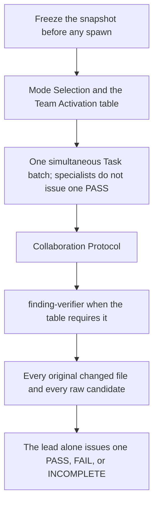

# Coordinate Review Team

## Purpose

Own the **Code Review Lead**'s risk-proportionate orchestration. Prefer
`team-live` only when isolated peers directly exchange messages **observed
by the runtime**. Otherwise prefer `team-relayed` whenever isolated
`Task`/subagents exist; use `native-solo` only if subagents are unavailable
or R0/R1 has no distinct investigation worth delegating. Never use consensus
or helper output to manufacture one `PASS`.

## Uses

* Rule: `contexts/review/rules/code-review.md`
* Skill: `contexts/review/skills/verify-findings/SKILL.md`
* Output contract: `contracts/review-evidence.md`
* Optional input contract: `contracts/requirements.md`
* Optional input contract: `contracts/test-basis.md`
* Optional input contract: `contracts/test-evidence.md`

## Working State

Before any spawn, freeze `review_id`, repository identity, resolved base/head
SHA (or a read-only workspace fingerprint), complete Git changed-file inventory,
`risk_profile` R0–R3, separable concerns, selected/omitted specialist roles,
and applicable acceptance/risk questions. Every specialist **including the
verifier** must receive the same identity and read-only boundary.

For a workspace review, hash HEAD, index, tracked changes and untracked file
content and recheck at the end. A moving target makes evidence `INCOMPLETE`.

## Review Profile

Review team sizing and transport remain independent of the declared review
profile. Follow `contexts/review/rules/code-review.md` for advisory vs gate
independence, requirement authority, finding calibration and stop conditions;
this skill alone owns team-sizing and relay policy.

## Team Activation

Use one isolated subagent per distinct concern, with the actual corresponding
`contexts/review/agents/{role}.md` as its role prompt. Lead is NOT a lens.

| Risk | First-pass specialist N | Finding verifier |
| --- | --- | --- |
| R0 | 0 (native lead) | not required |
| R1 | 0, or 1 with a distinct concern | only if that one identifies a blocker |
| R2 | 2–4, one per separable concern | if there is a material finding |
| R3 | 3–5 relevant roles | **always** an isolated verifier when subagents exist |

**Never** dispatch one all-purpose specialist at R2/R3 because peer messaging
is unavailable; **never** dispatch all seven by default. At most the six
investigation roles plus one `finding-verifier`. R2 with fewer than two
distinct concerns needs scope/risk reconsideration. **R3 with only one or two
genuine concerns is valid:** activate those lenses, record the below-ideal N
and keep the source-inspecting isolated verifier. Never invent concerns.

Concern mapping:

* contract / OpenAPI / AC → `specification-reviewer`
* correctness / behavior / regression → `correctness-reviewer`
* security / auth / PII / injection → `security-reviewer`
* reliability / locks / idempotency / data / partial failure → `reliability-reviewer`
* testing / scenario adequacy → `testing-reviewer`
* architecture / service boundaries / operations → `architecture-reviewer`

Record each omission and why it was not relevant. R3 with a runtime that has
no isolated verifier may use the lead's documented native falsification pass,
but must label it `native-second-pass` (never independent agent verification).
If the implementation author is the lead, switching roles does not establish
independence: all investigative specialists and the verifier must be isolated,
and the final `PASS` still requires a genuinely independent lead/session.

## Mode Selection — Strict Precedence

`team-live` requires observed delivery. A capability flag, shared memory, ordinary parallel Task calls, or an in-process queue does not qualify. Where sibling tasks do not communicate, resuming the existing subagent stays lead-mediated and remains `team-relayed`. If resuming is unsupported, create a new isolated Task with the narrow question and the original immutable target. Do not invent a prior conversation. No platform-specific API is canonical.

## Dispatch and Result Contract

Use `contexts/review/templates/specialist-dispatch.md` for neutral first-pass
assignments and `contracts/review-specialist-evidence.md` for specialist and
verifier outputs. Supply frozen facts, **not the Lead's hypotheses**, to
first-pass investigators. Every reply must be self-contained with a verified
target, inspected files, source-backed findings, actual runtime task identity,
and requests for other lenses. Never reference an unseen previous message.

## Collaboration Protocol

All messages are bounded, read-only, evidence-linked and anchored to the
same snapshot:

* `review_id`, `target_head_sha` (or workspace fingerprint), `message_id`,
  `thread_id`, `sender_role`, `recipient_role`, `kind`, `subject`,
  `evidence_refs`, `requested_action`, `response_to`, `status`.
* Kinds: `observation`, `question`, `challenge`, `response`,
  `escalation`, `resolution`.
* Evidence must identify file:line or bounded source, expected versus observed
  behavior, and provenance; never forward whole transcripts, irrelevant
  context or secrets.

A material question/challenge/escalation opens a thread, the recipient replies
with inspected evidence and the original requester resolves it. Merely
responded threads are not resolved. Failed Task, missing replies, stale target
or material disagreement remain open and prevent a clean verdict.

## Workflow

The diagram is the procedure. Team size and relay policy stay in Team Activation, Mode Selection, and Collaboration Protocol above. Apply `contexts/review/rules/code-review.md` for advisory versus gate independence.

## Output

Report `execution_mode`, `risk_profile`, `team_members` (role, concern
reason, actual subagent ID), `coordination` (actual direct audit vs
`Task+resume`/narrow Task/no bus), `peer_threads` (bounded relayed
questions/challenges, not full chats), `independent_verification`
(isolated-agent vs native-second-pass), complete file inventory/coverage,
and `n_justification` (concerns, selected/omitted roles and N).

`adapters/review/team_orchestration.py` is a provider-neutral reference
implementation whose host-supplied `TaskRuntime` protocol requires an actual
isolated Task batch, resume and optional direct-message audit. It never
spawns an AI model itself; `run_review.py` freezes the plan for that host.
Each host integrates the abstract task-batch, continuation and optional
peer-audit capabilities through an adapter; no vendor-specific API or
execution environment is required by the canonical workflow.

## Boundaries

* All roles are **read-only**; no edits, code generation, staging, commits,
  pushes, PR creation, reviews, approvals, merges or external distribution.
* No installation, OCR requirement, prohibited provider or extra permissions.
* No false `team-live`, fake Task IDs, fabricated dialogue, all-role
  fan-out, one all-purpose R2/R3 Task, or PASS by consensus.
* Never replace independence with a different role in the implementer's session.

## Stop Conditions

Report `INCOMPLETE` when the target changes, required files or Task
evidence are missing, R2/R3 allocation cannot satisfy distinct concerns,
material threads remain unresolved, an R3 verifier with available subagents
cannot be established, or independent review cannot be established.
An unavailable team runtime alone does not invalidate a **complete,
separately independent** native review.

## Optional Lean R2 Profile

For an ordinary R2 change with exactly two independent concerns, activate
those two isolated specialists. The verifier is needed only for material
findings, and challenges are relayed only when a real cross-lens dependency
requires resolution. This is cost guidance, not a relaxed quality gate.
