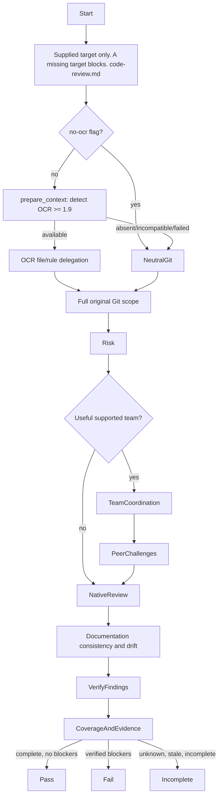

# Review Change

## Purpose

Perform a complete read-only review in `advisory` or `gate` profile with portable findings under `contracts/review-evidence.md`. The ready review record consumes a frozen advisory result. A gate claim consumes only externally attested gate evidence. Optional helper preparation can accelerate investigation but never defines scope, correctness or review completeness.

## Uses

* Rule: `contexts/review/rules/code-review.md`
* Skill: `contexts/review/skills/verify-findings/SKILL.md`
* Skill: `contexts/review/skills/coordinate-review-team/SKILL.md`
* Output contract: `contracts/review-evidence.md`
* Optional input contract: `contracts/test-basis.md`
* Optional input contract: `contracts/test-evidence.md`
* Optional input contract: `contracts/requirements.md`
* Optional input contract: `contracts/work-item.md`

## Working State

Track target and base/head identity; change boundary and stated claims; changed/selected/reviewed/excluded/unreviewed files; applicable requirements/contract evidence; documentation_assessment and affected documents; risk profile and affected consumers; deterministic check results and provenance; raw and verified findings; selected collaborative team mode/roles, peer questions and resolutions when applicable; limitations and review verdict.

## Workflow

The diagram is the procedure. Mandatory host-neutral preparation is Preflight.
Apply `contexts/review/rules/code-review.md` for findings, documentation drift, local checks, and the verdict.
Apply `contexts/review/skills/coordinate-review-team/SKILL.md` for team mode.
Apply `contexts/review/skills/verify-findings/SKILL.md` before a candidate becomes a blocker.
Apply `contexts/review/rules/high-risk-patterns.md` as falsification prompts. Do not restate those sources.

## Output

A review result conforming semantically to `contracts/review-evidence.md`. Prioritize actionable verified findings and clear coverage/status over cosmetic commentary. A native result is equally valid whether OCR or another helper was present.

## Boundaries

* Read-only: do not edit implementation, tests, configuration or repository state; do not stage, commit, push, post PR reviews, create PRs, merge, release or deploy.
* Do not use potentially mutating check commands without explicit permission. Do not install helper software, request additional credentials or transmit repository content outside approved boundaries.
* Do not invoke another context's internal agents or skills merely to obtain evidence. Consume portable contract material or explicit user-provided sources.
* Do not claim live Agent Teams support, direct messaging or independently isolated verification unless the runtime actually provided and recorded them.
* Do not publish approval, claim all checks passed, or certify an incomplete review. Offer findings for separately authorized remediation.

## Stop Conditions

Report `INCOMPLETE` when the target or required files are unavailable, mandatory evidence is stale/missing, coverage cannot be established, or **an unresolved ambiguity could change a blocker decision or high/critical finding**, as defined in `contexts/review/rules/code-review.md`. Lesser uncertainties stay visible but do not automatically stop PASS. Retain completed findings and explicit reasons; optional helper failure alone does not stop viable native review.

