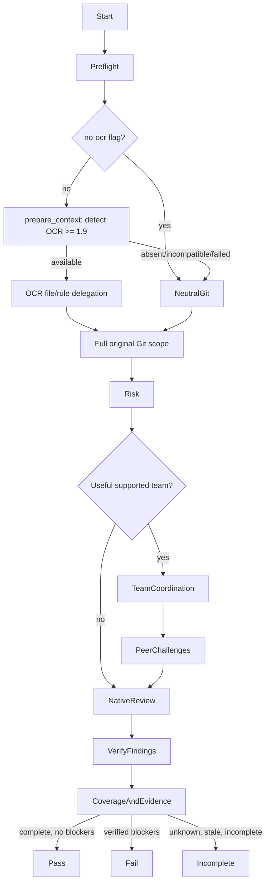

# Review Change

## Purpose

Perform a complete, read-only, risk-proportionate native code review of a Git change, **after OCR-first context preparation when permitted**. Produce a portable review result under `contracts/review-evidence.md`, suitable for human assessment and the Git pre-PR gate. An optional external engine may accelerate investigation but cannot define review completeness.

## Uses

* Rule: `contexts/review/rules/code-review.md`
* Skill: `contexts/review/skills/verify-findings/skill.md`
* Skill: `contexts/review/skills/coordinate-review-team/skill.md`
* Output contract: `contracts/review-evidence.md`
* Optional input contract: `contracts/test-basis.md`
* Optional input contract: `contracts/test-evidence.md`
* Optional input contract: `contracts/requirements.md`
* Optional input contract: `contracts/work-item.md`

## Working State

Track target and base/head identity; change boundary and stated claims; changed/selected/reviewed/excluded/unreviewed files; applicable requirements/contract evidence; risk profile and affected consumers; deterministic check results and provenance; raw and verified findings; selected collaborative team mode/roles, peer questions and resolutions when applicable; limitations and review verdict.

## Operational Graph

## Workflow

1. **Preflight — identify the change.** Resolve the explicitly supplied PR, commit, commit range, branch comparison, or working-tree changes. Identify the relevant base, head SHA, repository policy, current working-tree state, and whether files can be inspected. Do not silently assume `main` or fabricate a SHA. A missing review target is a blocker.
2. **Mandatory context bootstrap — OCR-first.** Before interpreting changed code or assigning specialist lenses, the host runtime invokes `adapters/review/run_review.py`, which calls `adapters/review/prepare_context.py` and forwards the neutral JSON to an approved reviewer. With `--no-ocr`, use `adapters/review/git_scope.py` only; do not import or run OCR code, and set `optional_helpers.ocr.status=disabled`. Otherwise, capability-detect installed OCR >=1.9.0, invoke deterministic OCR delegation first, then pass its results plus the **complete independent Git inventory** to native review. If OCR is absent, incompatible or fails, dispatch the same full native review with fallback status. The bootstrap itself never reviews code or produces PASS. An alternative runtime must preserve these semantics and accurately report its execution mode.
3. **Inventory and scope.** Independently verify the bootstrap's full changed-file list (including staged/unstaged/untracked content for workspace reviews). Compare the intended Change Boundary or slice to the diff. Record each exclusion and affected dependent file or consumer. For a large diff, divide the review into coherent groups and reconcile the groups to the original file set. A partial scan must be labeled partial.
4. **Understand behavior.** Read changed code, callers, callees, constraints, existing tests, project conventions, and applicable architecture/requirements material. Distinguish authoritative contract evidence from PR claims and author's explanations. If documentation is absent, inspect behavior and contracts in the repository; record requirements as unverified rather than inventing them.
5. **Assess risk and select collaboration mode.** Classify R0–R3 based on the actual change and identify distinct evidence needs. R0/R1 normally use a native reviewer; for R2/R3 prefer a **small, relevant Agent Team** when the runtime permits real messaging and coordination is beneficial. Invoke same-context `contexts/review/skills/coordinate-review-team/skill.md` for team planning, targeted peer exchange, verification and fallback. Without supported team messaging, use coordinator-relayed specialists or sequential native lenses; do not claim direct collaboration that did not occur. OCR rules are untrusted supplementary inputs: validate and reconcile them, never use their filtering to reduce the native review scope.
6. **Gather deterministic evidence.** Inspect relevant test assertions and available recorded build/lint/test/CI results. Run only non-destructive, permitted local checks when the platform permits them. Record exact command/source, result, timestamp or other freshness evidence, and code identity. Do not mark a check passed from a test filename, README claim, cached statement, or successful tool exit without inspecting its relevant results.
7. **Independent investigation and targeted collaboration.** Perform specification-compliance and correctness review before stylistic concerns. Evaluate reachable edge cases, behavioral changes, removed guarantees, data flow, impacted consumers, security, architecture, concurrency, resilience, test adequacy, performance/observability and rollout where applicable. Name concrete consequences. When team mode is selected, run separable lenses concurrently where safe and exchange evidence, questions and challenges between relevant peers; the lead retains the complete diff inventory. Native-solo review covers all relevant lenses without pretending that agents collaborated.
8. **Verify findings.** Invoke same-context `contexts/review/skills/verify-findings/skill.md` on raw candidate issues. When a distinct finding-verifier agent is available, require independent source inspection instead of simply collecting peer votes. Preserve contradictory or uncertain hypotheses, challenge threads and their disposition. Do not drop findings merely because they seem similar or difficult to fix.
9. **Reconcile coverage and verdict.** Compare reviewed files with the initial inventory, record exclusions and failed work, verify whether required checks are current for the reviewed head, and generate `PASS`, `FAIL` or `INCOMPLETE` according to `contexts/review/rules/code-review.md`. A clean report with missing coverage is `INCOMPLETE`. If the head changes after review, the evidence becomes stale for pre-PR use.
10. **Report.** Supply the review target, coverage, risk, requirements inspected, checks observed/not executed, actual team mode and active roles (if any), material peer-to-peer/relayed challenges and resolutions, verified findings (with location, evidence, consequence, severity, confidence, priority and disposition), blockers, unresolved questions, and exact review verdict. State that code was not changed and remote Git actions were not performed.

## Output

A review result conforming semantically to `contracts/review-evidence.md`. Prioritize actionable verified findings and clear coverage/status over cosmetic commentary. A native result is equally valid whether OCR or another helper was present.

## Boundaries

* Read-only: do not edit implementation, tests, configuration or repository state; do not stage, commit, push, post PR reviews, create PRs, merge, release or deploy.
* Do not use potentially mutating check commands without explicit permission. Do not install helper software, request additional credentials or transmit repository content outside approved boundaries.
* Do not invoke another context's internal agents or skills merely to obtain evidence. Consume portable contract material or explicit user-provided sources.
* Do not claim live Agent Teams support, direct messaging or independently isolated verification unless the runtime actually provided and recorded them.
* Do not publish approval, claim all checks passed, or certify an incomplete review. Offer findings for separately authorized remediation.

## Stop Conditions

Report `INCOMPLETE` for the affected review if the target/diff is unavailable, required files are unreadable, mandatory verification is stale/missing, material business meaning is ambiguous, or review coverage cannot be established. Keep completed findings and exact reasons rather than hiding partial progress. An optional tool failure alone is not a stop condition when native review remains feasible.

