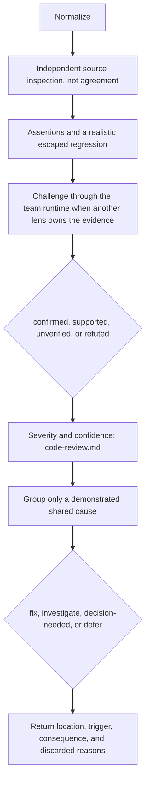

# Verify Review Findings

## Purpose

Independently investigate candidate code-review findings and produce traceable, evidence-backed classifications without discarding genuine defects or converting speculation into blockers.

## Uses

* Rule: `contexts/review/rules/code-review.md`
* Output contract: `contracts/review-evidence.md`

## Working State

Preserve each raw candidate's identity and originating specialist(s), peer challenge thread IDs and evidence status; inspected file and code location; alleged trigger and consequence; confirming and contradicting evidence; verification status; severity; confidence; deduplication mapping; and remediation disposition.

## Workflow

The diagram is the procedure. Apply `contexts/review/rules/code-review.md` for severity, external context, and amplified pre-existing risk. Record the result in `contracts/review-evidence.md`.

## Output

A normalized, traceable finding set under `contracts/review-evidence.md`, including raw-finding mappings, rejected reasons, unresolved concerns, and whether further verification is required.

## Source and External-Context Verification

Apply the single policy in `contexts/review/rules/code-review.md` for
pinned `external-context` evidence, `amplified-pre-existing` risk, conflicting
requirement sources, source inspection and the Lead's independent confirmation
of blocking candidates. Use `contexts/review/rules/high-risk-patterns.md`
only as falsification prompts, never automatic blocking criteria. Specialist
and verifier outputs must be self-contained and anchored to inspected source;
unavailable referenced messages are not evidence.

## Boundaries

* Independent, read-only analysis; do not change code or tests, accept risk for a stakeholder, publish PR comments, or determine Git readiness.
* A reviewer cannot prove a claim false merely because the relevant code was not inspected. If evidence is insufficient, use `unverified`.
* A second agent's agreement is not proof. Where the same session performs verification, identify it as a native second pass rather than independently isolated agent verification.
* An external filter or second LLM is optional; the native reviewer must perform the same verification when helpers are absent.

