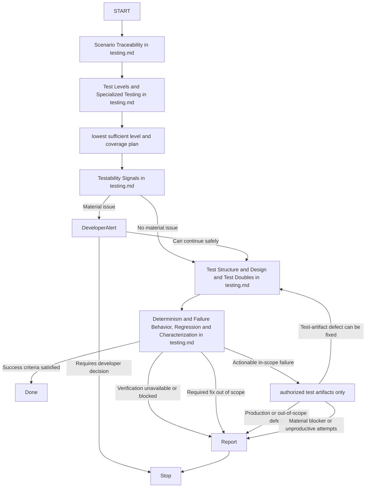

# Generate Automated Tests

## Purpose

Use when creating, extending, or modifying automated tests. Generate complete, maintainable tests while applying `contexts/testing/rules/testing.md`.

## Uses

* Rule: `contexts/testing/rules/testing.md`
* Optional input contract: `contracts/test-basis.md`
* Output contract: `contracts/test-evidence.md`

## Working State

The workflow progressively establishes and refines:

* Behavioral context, contract, scope, and boundaries.
* Optional portable Scenario Set with stable scenario identities.
* Optional requirement specification, acceptance/fit criteria, business examples, counterexamples, boundaries, failure model, or `contracts/test-basis.md` evidence when supplied.
* Material assumptions and unresolved uncertainty.
* Project testing tooling and conventions.
* Risks, examples, counterexamples, scenario partitions, failure assumptions, and relevant test techniques.
* Success criteria and test strategy.
* Generated or modified tests.
* Scenario-to-automation coverage mapping when stable scenario identities exist.
* Verification evidence and quality-gate outcomes.
* Blockers, uncovered scenarios, orphan tests when relevant, out-of-scope requirements, or unresolved failures.

## Workflow

The diagram is the procedure. Apply the section of `contexts/testing/rules/testing.md` named on each node. Do not restate it.

## Boundary

This skill may create or modify test artifacts. It may diagnose defects outside testing scope, but must not change production code or other non-test artifacts unless a separate explicit authorization grants that mutation.

## Output

* Start with a brief summary of the test strategy and material risks.
* If a **Developer Alert** is required, present it before the tests.
* Provide complete, copy-pasteable test code in standard Markdown code blocks.
* Report verification commands and outcomes, including failing, skipped, blocked, or unexecuted checks, regression evidence, measurable regressions, and material uncertainty; never imply successful validation when verification is incomplete.
* When scenario identities exist, include `contracts/test-evidence.md`-compatible coverage showing which scenarios are automated, partially automated, uncovered, blocked, passed, failed, or not run.
* Keep explanations concise; let test names and assertions describe the behavior.
